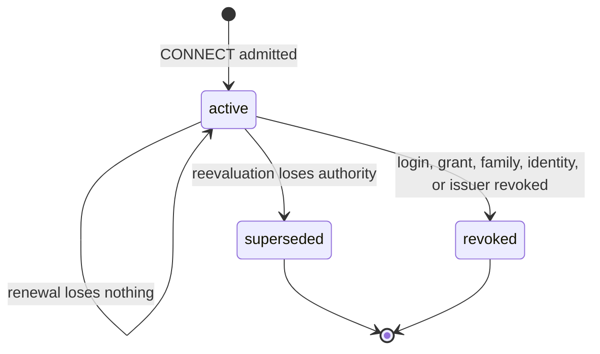
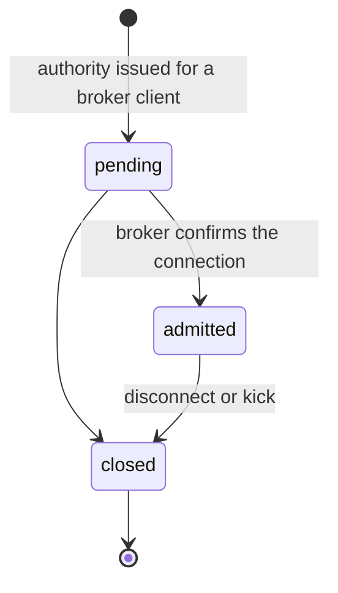
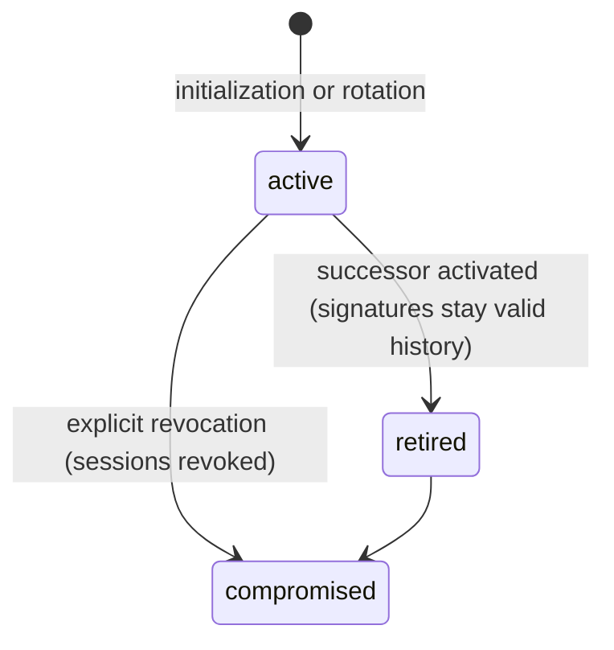

# Design: Trellis Authentication And Authorization

Status: Revision 7, unreleased. A clean break: there is no compatibility path
for GrantBinding, route tokens, or the former browser bind protocol.

This document describes the model: what Auth stores, how each record lives and
ends, how a connection receives authority, and how a policy change takes it
away. The [appendix](#appendix-rules-by-code-path) lists the detailed rules,
grouped by the code that enforces them. Related documents:
[administrative capabilities](./administrative-capabilities.md),
[Auth API](./auth-api.md), [Auth protocol](./auth-protocol.md),
[device activation](./device-activation.md), and
[operations](./auth-operations.md).

## The model

Auth owns every authorization decision in one SQLite database. A connection
never carries policy: it proves who it is, Auth compiles that principal's
current authority, signs it as a short-lived **session authority**, and admits
the connection with a transport policy derived from it. Providers and callers
verify signed authority; they never resolve roles, consent, or grants
themselves. When policy changes, Auth reevaluates the affected sessions and
retires any that lost authority, publishing signed revocations and kicking their
connections. NATS KV only distributes published material; it is never
authoritative.

## Entities

| Entity                         | Table                                                                          | What it is                                                                                                                                                              |
| ------------------------------ | ------------------------------------------------------------------------------ | ----------------------------------------------------------------------------------------------------------------------------------------------------------------------- |
| Principal                      | `auth_principals`                                                              | A user, service, or device identity. `active`, `disabled` (reversible), or `revoked`.                                                                                   |
| Login session                  | `auth_login_sessions`                                                          | One verified sign-in, local or upstream OIDC. OIDC logins carry verified claims with a freshness deadline.                                                              |
| OAuth client                   | `auth_oauth_clients`, `auth_cimd_clients`                                      | A registered public client, or one known only from its client ID metadata document.                                                                                     |
| OAuth grant                    | `auth_oauth_grants`                                                            | One user's approved delegation to one client binding (browser origin or native DPoP key): the selection, the approved capabilities and groups, and their consent basis. |
| Refresh family                 | `auth_oauth_families`                                                          | One chain of rotating refresh tokens under a grant. Revocation is irreversible.                                                                                         |
| Deployment, instance, identity | `auth_deployments`, `auth_instances`, `auth_provisioned_identities`            | An installed service or device participant, its running instances, and their identity keys.                                                                             |
| Capability, group              | `auth_capability_identities`, `auth_capability_group_members`                  | An API's unit of approval (`api.vN:area.action`) or a developer-defined bundle of them (`api.vN:name`), each with an identity generation and consent revision.          |
| Entitlement path               | `auth_direct_capabilities`, `auth_role_assignments`, `auth_oidc_role_mappings` | How a principal holds a capability or group: a direct grant, a role, or an identity-provider claim mapped to roles.                                                     |
| Logical authorization session  | `auth_authorization_sessions`                                                  | One runtime's continuing authority under one credential root. `active`, `superseded` (lost authority), or `revoked` (root gone).                                        |
| Session authority              | `auth_session_authorities`                                                     | An immutable, issuer-signed `trellis.session-authority.v1`, addressed by digest and retained as history.                                                                |
| Attachment                     | `auth_attachments`                                                             | One physical broker connection bound to a session authority and ephemeral NKey: `pending`, `admitted`, or `closed`.                                                     |
| Issuer                         | `auth_authorization_issuers`, `auth_issuer_rotations`                          | Auth's signing key: `active`, `retired`, or `compromised`, linked by signed rotations.                                                                                  |
| Enforcement work, effects      | `auth_enforcement_work`, `auth_post_commit_actions`                            | Durable scoped reevaluation work, and ordered effects (revocations, kicks, publications) committed with the change that caused them.                                    |

## Lifecycles

A logical authorization session keeps one ID across renewals only while nothing
was lost; any reduction retires the ID for good.

A retired session's credential root may still be valid; the runtime then
connects again under a new logical ID with whatever authority remains.

An OAuth grant is created when the user approves, lives until it expires or is
revoked, and owns refresh families. An approval that names the app's current
grant widens it instead (see `auth-protocol.md`): its approved capabilities only
grow, and its revision advances. Revoking a family retires every session
whose original family it was; revoking the grant revokes all of them.

## Entitlements

One compiler (`policy::evaluate`) decides authority, reading one SQLite
transaction:

1. **Holdings.** The union of the principal's direct grants, role assignments,
   and, for an OIDC login, roles mapped from that login's fresh verified claims.
   A held group counts as its current members. The initialized administrator
   additionally holds every administrative capability inherently, and every
   active user holds the `trellis.auth.v1:account` group inherently: their own
   profile, password, sign-ins, linked sign-ins, connected apps, device links,
   and app settings. Those RPCs act only on the caller's own account, so
   using one's own account needs no role, and no role or grant can take it
   away; an app still receives it only through the user's consent. A role marked
   `assignToNewUsers` is assigned, as an ordinary revocable assignment, to each
   user `Users.Create` makes afterwards; marking it is the policy decision, so
   creating the user needs no role-management rights. Existing users are not
   changed.
2. **Selection.** What the credential asks for: an app's requested
   capabilities and groups, or a deployment's installed participant selection.
3. **Consent.** For an OAuth grant, only what the user approved at the approved
   consent revision. A selected group yields the members of the revision the
   user approved, less any since removed.
4. **Result.** Approved capabilities (holdings ∩ selection ∩ consent), required
   selections that are missing, accepted API generations, provider bindings,
   resource-binding evidence, explanations, and the earliest deadline among the
   credential and each carried right.

Each entitlement path stands alone: losing one path never removes a capability
another path still grants, and freshness expiry removes only the affected OIDC
path.

## Issuance pipeline

0. Every client presents the sentinel user's JWT, which the OAuth metadata
   publishes as `trellis.natsSentinel`. The sentinel is a bearer user of the
   `AUTH` account allowed nothing, and `AUTH` names Trellis's callout user, so
   NATS hands the connection to the callout. Servers carry no
   `default_sentinel`.
1. The broker's Auth Callout receives a CONNECT, checks the server, account,
   expiry, and request key, and verifies the nonce signature with the
   connection's ephemeral NKey (`auth_callout.rs`).
2. The CONNECT token is the credential: a short OAuth admission bound to the
   DPoP key from the token endpoint, or a provisioned identity proof signed by
   the installed identity key (`revocation.rs`, `admit_connection`).
3. In one transaction, Auth checks the credential root: principal active; login,
   grant, and original refresh family live; client active; or deployment and
   instance current (`authorization_sessions.rs`, `credential_snapshot`).
4. The compiler evaluates authority. A missing required selection denies
   admission.
5. On renewal, the logical ID survives only if no still-usable authority issued
   under it carried anything the new result lacks (`loses_authority`).
   Otherwise the session is retired and a new ID begins.
6. Auth signs the session authority (64 KiB budget) with the transaction's
   current issuer, stores it with its comparison projection, records the
   session and a pending attachment with its transport policy, and commits the
   publication effect.
7. The Callout returns an authorized-user JWT carrying that transport policy.
   The SDK verifies its signed authority before any application work.

## Enforcement pipeline

1. Every policy change is an idempotent aggregate mutation. It authorizes the
   actor, applies the change, and commits scoped enforcement work in the same
   transaction.
2. The commit wakes the enforcement and effect workers. Work naming one session,
   grant, login, identity, principal, or deployment runs in a targeted lane
   ahead of broad scans (an API, capability, role, client, provider, issuer, or
   everything), which yield at page boundaries.
3. A worker pages the sessions in scope through indexed lookups, reevaluates
   each with the same compiler, and compares with its live authorities.
4. A session that lost authority is retired; one whose root is gone is revoked.
   Retirement records its cutoff, signed revocation, and exact attachment kicks
   atomically.
5. The effect publisher sends signed revocations before the kicks that depend
   on them, and kicks only the exact broker connection it recorded. When a
   request revokes the caller's own session (logout, or a companion revoking
   its own grant), that session's revocation and kicks wait five seconds so
   the caller can receive and verify the reply over the same connection. Auth
   refuses the session from the cutoff; every other session in scope is
   enforced at once.
6. SDKs keep a verified mirror of revocations and use it only to check other
   parties: a provider checking a caller, a caller checking a responder.
   Revocation is eventually consistent. See [revocation is eventually
   consistent](#revocation-is-eventually-consistent).

### Revocation is eventually consistent

Auth and the broker enforce revocation of a session at once: Auth refuses its
admission and renewal from the cutoff, and the effect publisher kicks its
connections right after publishing the signed revocation. A participant's
mirror learns of it when the revocation's JetStream update reaches it, normally
well under a second later, and from then on refuses that session's requests
and replies.

A mirror that is down or lagging, as during a reconnect, a broker restart or a
consumer the broker refused, never blocks anything. Requests on a participant's
own session are sent, and other parties' messages are checked against the
revocations the participant has observed so far, while the mirror catches up in
the background. No participant refuses to send on its own session because of
its mirror; the broker and Auth enforce that session's revocation. Nothing in
connecting, renewal, Live, jobs or event consumers waits for the mirror either.

An event is judged at the time its publisher signed it, under the authority it
names, not at the time it was recorded or delivered: one signed while the
session's authority was valid and before its revocation cutoff is genuine. An
outbox backlog dispatched after its session renewed or reconnected is therefore
accepted, and a publish that waits across a renewal is sent, while an event
signed after the cutoff, or published after it with a backdated signature, is
refused. See [event signing time](./auth-protocol.md#event-signing-time).

There is no separate staleness bound, because the authority lifetime is one: a
revoked session cannot renew, so its signed authority stops verifying anywhere
once it expires, at most one authority lifetime (`context_lifetime_seconds`,
300 by default) after the revocation, even at a participant whose mirror never
catches up. A participant that cannot reach Auth for longer than that cannot
renew its own authority either, and expired authority authorizes nothing.

## Consent and delegation

Required access has no choice: approving the consent grants it. Optional
access the user can be granted starts selected, unless an earlier answer
declined it; optional administration starts unselected and takes its own
confirmation. The server rechecks the submitted selection against current
holdings in the approving transaction, and a changed meaning requires a fresh
presentation. Every answer on the consent page is remembered, approvals and
declines alike, with no choice to forget them; only approvals of
administration are not, because each is confirmed. Remembered consent is per
user, client binding, capability or group, identity generation, and consent
revision.

A group grants its members. Its holders see membership changes immediately;
growth requires a higher consent revision, so an app keeps the members its user
approved until asked again, while removed members disappear everywhere.

Administrative capabilities, and groups that contain one, carry two
safeguards configured under `[auth.administration]`: a separate confirmation
step and registered clients only. See [administrative
capabilities](./administrative-capabilities.md).

## Catalog acceptance

One accepted definition exists per API major. Review authenticates the package
evidence, computes compatibility, records action, capability, group, and consent
changes, and binds the policy revisions it affects; acceptance rechecks all of
them in its transaction. Normal acceptance raises the accepted revision, and new
actions and memberships record the revision that introduced them, so an older
signed authority cannot gain them. Force replacement starts a new generation.
Only the APIs Trellis ships may use the `trellis.` namespace.

## Durable state and caches

Session authority rows are permanent history: expiry, disconnect, grant
replacement, login revocation, and issuer rotation never delete them, and
explicit revocation is separate associated state. Effects and typed events are
ordered post-commit actions; delivery preparation is claim-fenced and retries
reuse the exact prepared bytes. KV mirrors, connection inventories, and SDK
caches are rebuildable; there is no durable rollback floor or context cache.

---

## Appendix: Rules by code path

### Listeners and installation identity (`config/`, `listener.rs`, `oauth/http.rs`)

Fresh initialization generates `auth.instance_id` as a canonical ULID. Retain it
with the installation configuration and database across restarts and all key
rotations; startup requires it rather than inventing a new identity.

Trellis serves one HTTP listener, `[http]`: its `public_origin` is sign-in's
issuer and the address the CLI, services, devices and apps connect to, and it
serves the OAuth routes, discovery, health, and the bundled Console. The
Console is a registered browser client (`trellis.console`) served at
`/console` on the Trellis origin, the one application that origin hosts; its
callback is `/console/login`. Its scripts then share an origin with sign-in,
so a script injected into the Console could drive the sign-in pages as the
person viewing it. `[console] origin` moves it to a hostname of its own,
answered by the same listener: that host serves the Console, sign-in pages
refuse it, and Console paths on the Trellis host redirect there, so the
browser isolates the two. `[console] enabled = false` serves no Console: its
pages are absent and sign-in refuses `trellis.console` (authorization and
refresh alike), whatever answers its callback. Its registration stays, so
turning the Console back on needs no new installation. Its callback always
follows the configured origin, `[console] origin` or else `public_origin`,
rather than the address stored when the installation was created, so editing
either keeps Console sign-in working. The listener's transport
is one of:

- `tls`: HTTPS with `certificate_chain` and `private_key` PEM paths resolved
  relative to the runtime configuration. The origin must be HTTPS. Startup
  refuses an expired certificate or one whose SANs do not name the origin host,
  and the listener reloads replaced files without a restart; a replacement that
  fails to load keeps the previous certificate serving.
- `proxy`: plaintext behind an HTTPS-terminating reverse proxy. The public
  origin must be HTTPS and `trusted_proxies` lists the proxy networks. Peers
  outside those networks receive `403`. The client address used for per-client
  limits is the first untrusted `X-Forwarded-For` entry read right to left, so
  a client cannot spoof it past a trusted proxy. The proxy must preserve `Host`.
- `loopback_development`: explicit plaintext restricted to an HTTP loopback
  origin and a loopback bind address. An omitted Trellis transport selects it
  and binds loopback by default. It is never a TLS fallback.

There is no insecure-origin allow-list: a remote origin is served only over TLS
or behind a trusted HTTPS proxy, because OAuth's `__Host-` `Secure` cookies and
browser credential custody require a secure context. No client may register a
callback on the Trellis origin except the Console at `/console/login`. A
Console origin of its own must differ from the Trellis origin and share its
scheme; one on the same hostname (another port behind a proxy) is allowed but
logs a prominent cookie-scope warning, because cookies are not port-scoped.
Browser origins are trusted from the redirect URIs of registered and
URL-identified clients, never from server configuration. Development mode
(`trellis-server --dev`) uses the same listener, over loopback HTTP or, with
`--host`, with one generated certificate.

A Console on its own origin serves RFC 9728 protected resource metadata
(`/.well-known/oauth-protected-resource`) naming the Trellis origin as its one
authorization server. Native discovery given the Console's address, which
answers authorization server metadata with no JSON document, follows that
single named issuer once and then validates it as usual. The Console's own TLS
trust authenticates the pointer, so people may sign in with the address they
use in a browser.

Request admission budgets each client address, and additionally each browser
`Origin` when the header is present. Requests without `Origin` (native token
clients, navigations, asset loads) share no common budget. Expired budget
windows restart when next used and the table is swept only when full. Forwarding
headers are ignored unless the TCP peer falls inside `[http] trusted_proxies`, a
list of CIDR ranges (`/32` or `/128` for one address). For a trusted peer, the
client is the right-most `X-Forwarded-For` hop outside those ranges, and a
malformed header is rejected. Use it for a proxy in front of a TLS listener,
such as one that re-encrypts. A `proxy` transport with `trusted_proxies` admits
only those peers and presents the forwarded client by the same walk. Without
them it admits every peer and takes the client from the last
`X-Forwarded-For` entry, for a network that already admits only the proxy,
such as a rootless Podman network that rewrites source addresses.

Remote deployments use native TLS NATS and WSS in addition to the HTTPS
Trellis listener. Native NATS always terminates its own TLS, because its
protocol upgrades to TLS after a plaintext `INFO` and an ordinary TLS proxy
cannot terminate it; only the WebSocket listener may sit behind an
HTTPS-terminating proxy. A proxy in front can send every request asking for a
WebSocket upgrade to the broker's plaintext WebSocket listener and everything
else to Trellis, so the WebSocket shares the Trellis origin at any path. The
runtime can apply that rule itself: with `[http] nats_websocket_upstream`, the
Trellis listener relays every WebSocket upgrade to the broker and advertises
`wss://<Trellis origin>` instead of configured WebSocket hints, so a client
trusts one host and certificate. Production deployments with publicly trusted
certificates can still expose the broker's WebSocket listener directly. A
deployment that keeps native NATS private advertises an empty `[client]
nats_servers`, so discovery lists only WebSocket endpoints; Rust and TypeScript
native clients use native endpoints when any are advertised and otherwise the
WebSocket ones, never a mix in one connection. Both HTTP listeners answer
`/healthz` and `/readyz` before any `Host` check, so a load balancer that
addresses a target directly can probe them. Runtime startup selects its rustls provider before
opening NATS. `[nats] ca_certificate` names a private CA the runtime trusts for
its own broker connections, built-in providers, and split-role Auth discovery;
publicly trusted brokers omit it. Every NATS connection Trellis makes, the
runtime's and each Rust client's, takes TLS from its server URL: `tls://` and
`wss://` always use it, and so does a server whose INFO requires it. A CA file
or broker name only says what to trust, so a plaintext loopback `nats://`
broker still connects beside a private CA for HTTPS. A broker certificate not
issued for the name dialled (or `RuntimeAuthorizationTrust.nats_server_name`),
or not chaining to a trusted CA, fails the attempt at once and is not retried.
Neither SDK dials servers the broker reports or reconnects a connection in
place: after a loss it opens a new transport generation over the advertised
list.

A client whose broker is lost opens a replacement generation on its own
schedule. A TypeScript client that is idle backs off between failed attempts:
1 s, 2 s, 4 s, then 8 s. While a caller waits for the transport (a finite RPC,
an Operation, a Live opening, a publish awaiting its acknowledgement, or a
request waiting for verified authority to return), it retries 1 s after the
last failed attempt instead, however many callers are waiting, so a request
sent as the broker returns does not time out behind the idle schedule.
Background work keeps the idle schedule: a wait with no deadline, and a
service's health heartbeat, never pull an attempt forward, so a running service
does not retry once a second for a whole outage. A
waiting Rust caller asks for an attempt every 500 ms within its deadline, so it
has no idle backoff to wait out.

### Installation TLS (`crates/bootstrap/src/tls.rs`, `tls.rs`)

Production installations serve operator-supplied certificates (`mode = "tls"`)
or sit behind an HTTPS proxy that holds them (`mode = "proxy"`). NATS TLS is
the NATS operator's; Trellis only trusts it, through `[nats] ca_certificate`
when it is private. `mode = "generated"`, for development and tests, makes an
installation CA in the data folder's `tls/` whose name constraints permit only
the public and Console hosts, and a short-lived serverAuth leaf carrying its
names only in SANs. The running server reissues the leaf from the same CA
within 30 days of its expiry, checking every 12 hours, and the listener
reloads it; clients that trust the CA need no change. Changed names make a new
CA. The server holds the CA key, which is why generated TLS is not for
production.

`[tls] generated_ca_certificate` marks an installation serving its generated
CA. The runtime then warns operators at startup with the CA's SHA-256
fingerprint, and the bundled Console and the Login Portal show every user a
short banner: this Trellis is using self-generated certificates and may not be
suitable for production. Trellis never installs system trust and never disables
verification.

Clients trust a private installation CA only through explicit configuration:
`RuntimeAuthorizationTrust.root_certificates` in Rust (supplied by provisioning,
`discover_native_oauth`'s roots, or `trellis login`'s `--ca-certificate` or a
CA the user accepted by fingerprint and pinned), and the
Node runtime's `NODE_EXTRA_CA_CERTS` for TypeScript participants. Non-empty Rust
roots are the only trust anchors for that installation's OAuth and broker TLS. A
broker or metadata response can never supply them. A runtime reaching the broker it
manages at loopback still checks the broker's certificate in full, against the
host in the configured NATS server URL
(`RuntimeAuthorizationTrust.nats_server_name` for its own providers), so a
supplied NATS certificate needs only the name clients use. Observable configured origin
conflicts fail before binding a listener. Operators must also keep external
reverse-proxy routes and aliases separate: the runtime cannot inspect an
unconfigured proxy's routing table or discover that two public hostnames are
mapped onto one origin.

### OAuth storage key custody (`oauth/storage.rs`)

Fresh initialization provisions `oauth_storage_key` in `secrets.toml`,
independently of the online issuer, as a canonical base64url 32-byte key.
Retain and back up this key together with Auth's database. Issuer rotation does
not replace it. The runtime refuses a `secrets.toml` that is a symlink, has
other hard links, is not owned by the process user, is readable by anyone else,
or exceeds its size bound, opening it without following links. The OAuth
adapter refuses a missing or malformed key and authenticates existing encrypted
OAuth material before accepting new writes. Startup never generates a
replacement key.

### Authorization HTTP boundary and Portal (`oauth/http.rs`, `oauth/portal.rs`, `portal/`)

The OAuth adapter bounds form bodies and per-peer/origin request admission,
rejects untrusted Host/HTTP2 authority and cross-origin portal mutations. Public
discovery and issuer-chain GETs allow credential-free cross-origin reads,
including first contact from an unregistered application. Token, device, and
revocation endpoint CORS remains limited to validated client callbacks;
cookie-authenticated Portal mutations do not acquire permissive CORS. Forwarding
headers do not select the peer identity. Expiry cleanup removes transient
portal, proof, device, and token state without deleting immutable authority or
audit evidence.

Portal documents use `Referrer-Policy: same-origin`: cross-origin destinations
receive no referrer, while same-origin forms retain the Origin required by the
strict CSRF check. Accepting `Origin: null` is not a fallback. Own-context
introspection binds its reply to the ephemeral key's derived inbox namespace;
the responder checks that routing before publishing either success or errors.

Administrators theme the Portal per installation and per OAuth client through
`Auth.PortalThemes` (`portal_themes.rs`), stored in `auth_portal_themes` and read
on each request, so a saved theme shows at once: a name, a logo, the Portal's
own palette (hex values only), copy for the sign-in heading, subtitle, and
footer, and an installation-only stylesheet. The installation theme needs
`platform.manage`; a client's theme needs `clients.manage`. Puts replace the
whole theme and are revision-fenced. Theming never changes what the Portal
decides: consent renders from Auth's presentation, a client theme cannot add
CSS, the client theme is resolved from the server's record of the transaction
rather than the request, logos must match their declared image format, and
theme assets are served same-origin with a sandboxing CSP. Every Portal page
links `/portal-theme/stylesheet.css`, which is empty without a stylesheet. The
Portal CSP allows same-origin images for the logo.

#### Who is signed in, and using a different account

A Portal flow never continues as an existing Portal login without saying who
that is. The consent page (app, CLI, native and Device Code sign-ins alike),
the device approval page and the identity-link page show the signed-in person
by name with their username or email, and offer "Use a different account".
When `/authorize` finds a Portal login, it sends the browser to
`/consent?...&account=confirm`; if nothing is left to decide there, so the
sign-in would otherwise finish without a page, the Portal shows "Continue to
{app}" with "Continue as {name}" (the same consent page without
`account=confirm`, which then finishes as before) and "Use a different
account". A sign-in made within the flow itself, by password or OIDC, does not
ask again. An identity link opened while signed in as someone other than its
target says so and offers only the switch.

"Use a different account" posts `/portal/switch-account` with the CSRF token and
the flow: a `transaction`, a device `review`, or a `link` token. It rotates the
portal session's cookie and CSRF secrets, detaches the session from its login
and returns to the flow's sign-in page. The portal session ID stays, so every
pending flow bound to it keeps its original request (client, capabilities,
PKCE, state, redirect) and continues for whoever signs in next; the presentation
shown to the earlier person no longer matches the new login and is presented
again. The earlier login is not revoked: apps, CLIs and devices signed in
through it keep working, and only this browser stops using it. The switch sets
`__Host-trellis-portal-reauth` like `/logout`, so the next OIDC sign-in asks
the provider again instead of its session signing the same person straight
back in.

Console and OAuth portal are separate required frontend apps. Their build tools
use Node 24 or 26 (CI runs 26), npm workspaces, and Vite; embedded builds compile into staging
before replacing only owner-marked output. Production builds require real
embedded assets; placeholder assets and optional Console builds are not
substitutes for the product.

The consent page lists required access first, without checkboxes, as what
approving grants. Optional capabilities and groups the user can be granted
follow with checkboxes, checked unless the user declined them before for this
client at the current `grants` text; optional administration starts
unchecked. Select all and Clear all are explicit actions over all optional
access the user may grant, administration included. Optional access the user
can't be granted (through their roles, grants, or sign-in provider, or
administration for an unregistered app) is not offered at all; required access
they lack is listed as not available, with a note to ask an administrator, and
approval is blocked. Administrative approvals
are never remembered and take a separate confirmation step, except for
administration the app is allowed without asking (see below). A requested group
is shown with the capabilities it includes. Each choice reads its own title,
grouped by area, and a request across several APIs heads each API's choices
with the API's title. The page names who is signed in by display name with
their username or email, never by principal ID. Selection is presentation, not
authorization: the user must still submit approval, and the server rechecks the
submitted selection against current authority.

The page is skipped when nothing is left to decide: every capability or group
the app asks for that the user can have is either allowed without asking (see
below) or answered before at its current identity generation and consent
revision, so an unchanged `grants` text. A remembered decline stays declined
at sign-in without the page. The page asks about it again only when the app
asks again with `prompt=consent`, which the browser SDK sends when the person
uses an optional capability they haven't approved (the ask-at-use redirect or
popup). Remembered approvals reused this way keep their remembered expiry.
Optional access the user can't have doesn't count, so it never forces the
page, and nothing about it is remembered: once they hold it, it is offered.
Only browser sign-ins skip the page: native and Device Code sign-ins always
ask, with remembered approvals preselected, and their answers are remembered
the same way. An app asking for nothing skips it only when registered.

Registered-client implied capability consent is browser-only and limited to the
configured subset, the requested selection and the user's current entitlement.
It never substitutes for native approval. Device Code consent shows the user
code beside a warning to compare it with the device and to stop if someone else
sent the code or link; it is not a separate required confirmation. Device codes
last 15 minutes, and the issuer returns `verification_uri_complete` so native
clients print and QR-encode a link with the code filled in.

Code and device consent presentations are retained in their encrypted,
expiring authorization artifacts. Approval submits the presentation identity and
explicitly selected optional capabilities. The grant transaction consumes that
exact presentation and rechecks the displayed capability identity generation,
consent revision, API generation, and current availability. Changed capability
meaning, a superseded form, or lost required availability requires a fresh
presentation; unrelated entitlement changes do not invalidate the form.

### OAuth clients (`lifecycle.rs`, `rpc_credentials.rs`, `initialization.rs`)

The bundled Console's OAuth registration is runtime-owned. Initialization
registers it against the configured Console application origin using the
ordinary registered-client store, then exposes its public client ID and validated
callback URI through Console configuration. Operators do not manually register
the bundled Console. Its client ID is neither a deployment ID nor a secret.
Initialization registers it with everything in the built-in APIs, the only
ones it asks for, allowed without asking: each group, and each capability no
group includes. A listed group allows its current members. A registered
browser client whose implied capabilities cover everything it requests that
the user holds
signs in without a consent page, administration included: the administrator
who allowed it confirmed it. Allowing an administrative capability (or a group
with one) without asking hands it to whatever answers the client's callbacks,
so saving a client whose list includes one requires
`trellis.auth.v1:platform.manage`, like changing who holds administration. That
covers changing such a client's callbacks too. A client saved that way is
marked in its metadata; sign-in asks for the administrative capabilities of a
client without the mark, such as one saved before this rule. The user's own
holdings remain the limit; when
they lack something the client requires, or it asks for anything neither
implied nor remembered, the ordinary consent page is shown. Administrators edit the Console's list like
any other app's.

The grant keeps what the client's list allows that the app asks for even where
the user doesn't hold it yet. Evaluation still requires the user to hold it,
so a role or grant given later reaches the app at the session's next authority
renewal, with no new sign-in: an administrator assigning a role to someone with
the Console open sees the new pages appear for them within one authority
lifetime. Administration on the list arrives the same way without a separate
confirmation, since the administrator who allowed it without asking confirmed
it; administration an app asks for that isn't on its list still takes the
user's own confirmation. Access an app must ask for is never kept this way: an
app the user signed in to before they held it gains it only after they approve
it.
Production administrator seeding initializes the administrator and registers
`trellis.console` and `trellis.cli` in one idempotent aggregate transaction. CLI
is an explicitly registered native Device Code/refresh client without a callback
listener or implicit loopback trust. Registration uses the newly created
administrator's `trellis.auth.v1:clients.manage`. Replay returns the saved
result without re-registering or re-enabling a modified client; ordinary startup
does not change client registration. Registration does not itself grant the user
any capability: delegation still requires the user's holdings and explicit
consent.

Administrative client Put derives supported flows on every revision: browser
with callbacks uses Authorization Code and refresh; native without callbacks
uses Device Code and refresh; native with callbacks uses both flows and refresh.
It replaces prior flow metadata while retaining unrelated registration metadata.
Adding/removing native callbacks enables/disables Authorization Code. Kind
remains immutable because it fixes credential binding semantics; switching kind
requires a new client ID. Native HTTP loopback callbacks need no development
flag, while browser plaintext loopback callbacks require it and retain exact
port/origin matching. HTTPS loopback callbacks are authenticated by TLS like any
other host. An administrator-registered development client, including a
localhost Console, is a registered client; neither development mode nor a
localhost redirect establishes anything further.

Provisional CIMD metadata and its encrypted OAuth engine client artifact are
admitted atomically, with a shared limit of 128 unapproved clients and 16 MiB.
Both receive a five-minute lifetime. Expired, unreferenced pairs are evicted
before admission; exhaustion returns `temporarily_unavailable`. A live pending
authorization retains its exact reviewed metadata until that transaction expires
and rejects replacement with a different document during that interval. Approved
grants retain their client protocol identity and redirect information, not the
full fetched metadata, until their remaining lifecycle ends. Cleanup preserves
refresh-reuse evidence for a still-live family and never deletes authority
history or administrative client registration.

### Upstream identity (`oauth/oidc.rs`, `oauth/upstream_http.rs`)

Dex is exclusively a real upstream OIDC test dependency, not a deployment
component. Trellis validates upstream nonce, signature, issuer, and audience
before translating verified claims through its own role mapping and consent.
Fresh claims replace earlier observations only for the selected upstream subject
at that provider. Two linked identities belonging to one user do not supply or
remove each other's mapped roles. Direct grants remain independent of claim
freshness or upstream role removal.

When an OIDC sign-in fails after the callback has matched its flow, Trellis
returns the browser to the sign-in or device-approval page it came from, with
`error=upstream_login_failed`. Failures before that point have no page to go
back to and return a plain OAuth error. The reason is kept in memory for ten
minutes, keyed by the portal session and the transaction or device review, and
`/portal/providers` returns it to that browser only. A link alone cannot make
the page show text. A reason is either the provider's own `error` and
`error_description`, from its redirect or its token response, or the step
Trellis could not complete: no linked account where the app allows no sign-up,
a provider changed or turned off mid-flow, discovery, or ID-token
verification. Account linking keeps the bare error, because it has no page to
return to.

### The capability compiler (`policy.rs`)

Pending backing resources do not remove an ordinary user's capabilities.
Approval never adds an unknown or declined optional capability at renewal.
Renewal evaluates the grant afresh against current holdings, so it adds what
the grant holds once the user holds it, as well as removing what they lost.
Compatible API expansion is available to a renewed context only while the
capability remains approved at the same consent revision.

A fresh answer on the consent page records grant-local consent provenance and
is remembered as the binding's latest decision: it overrides older remembered
declines or expired approvals, and it reaches the binding's other live grants.
Reused remembered choices must still be approved and inherit their optional
expiry. Later shared decisions and explicit withdrawals still constrain
existing grants. Approval commits scoped enforcement work atomically when it
changes remembered consent.

Deadline reductions compare each outstanding context with its shared credential
limit and the current limits of only the rights that context carries. Newly
gained capabilities cannot shorten older, narrower authority. Their limits bound
newly issued contexts, not the persistent logical-session root; spent contexts
are excluded after their acceptance deadline.

Trusted native device provisioning commits the device record with its
principal, deployment, instance, identity key, and entitlements before
authority issuance.

### Sessions and issuance (`authorization_sessions.rs`, `auth_callout.rs`)

Canonical signed session authority is limited to 64 KiB by both issuer and
verifier. Raw parsing applies the same allocation bound even when a caller's
local policy allows more. Issuance fails before authority or attachment state is
committed when the shared budget is exceeded.

A user principal's authority carries the non-critical `trellis.user.v1`
extension: the user's own display name, optional given/family names and email,
and email verification, read from the stored profile at issuance. Verified
request and event callers project it as `user` (including the stable photo URL
when the user has one), so a provider can show who is
calling without directory consent; it identifies, never authorizes, and profile
edits reach providers when Auth next issues the session's authority. Service and
device authorities never carry it.

Provisioned service/device CONNECT proofs identify the installed credential and
bind its identity-key signature to the fresh runtime/session NKey, target
installation/account, and validity window. Clients do not assert deployment,
instance, participant, or implementation authority. Auth resolves those from its
current provisioning records; an ambiguous credential binding is rejected rather
than selected implicitly. Provisioning supplies connection endpoints and pinned
installation/account/issuer trust, not another copy of deployment policy. The
Auth-signed session authority exposes the verified binding to the SDK, which
still checks its generated provider implementation against the accepted
evidence.

Auth checks the current credential/root, runtime identity, and proof key before
issuing `trellis.session-authority.v1`. It signs canonical bytes and commits the
immutable context, logical-session association, and publication work together.
Resolution by digest returns that exact committed object even after restart.

Renewal compares the new evaluation against every still-usable authority issued
under the session, using the comparison projection stored with each: carried
capabilities, API generations, provider bindings, resource-binding evidence, and
deadlines. Identical projections are compared once, at their latest expiry. A
narrower newest context cannot hide an older broader live context.

Reduction irreversibly retires the ID. A surviving root can reconnect with a new
logical ID after reevaluation. Disabled principals, revoked grants/logins or
provisioned identities, and compromised keys cannot use this route to regain
authority. Physical attachments bind the logical ID to an exact server/client
association, an attachment marker, and the same ephemeral NKey as its proof key.
Attachment admission reevaluates inside the transaction; delayed enforcement
cannot admit an already-retired or newly-reduced session.

OAuth CONNECT retains the original verified refresh family on its logical
authorization session: immutable `original_refresh_family_id` and
`refresh_family_lookup_hash`, with the hash/grant pair referencing the actual
OAuth family's record. Authority renewal, OwnContextGet, Admission.Renew, and
CONNECT reread that exact family's revocation state and absolute deadline; a
different live family of the same grant cannot replace it. The family deadline
limits the shared session root, separately from per-capability deadlines.
Refresh-token rotation preserves the original family identity and deadline.

`Admission.Renew` accepts the live session's ordinary verified ephemeral-key
request and a context digest owned by that exact principal/runtime/session/key.
In one transaction it rechecks current policy, validates and retains a bounded
candidate authority, and uses the token endpoint's signing owner to return a
short OAuth admission for the same key, runtime, grant, login, client, and
original family. Its lifetime is at most 300 seconds and cannot outlive the
candidate authority or family. It neither rotates a refresh token nor provides a
durable reconnect credential. Invalid roots retire the session and enqueue the
ordinary cutoff and kicks; renewal never revives its retired logical ID.
Provisioned credentials still require the client's identity-key signature:
`Admission.Renew` returns `provisioned_signature_required` for that
prerequisite, and Auth never signs on the client's behalf.

Already admitted Trellis connections may request their own context for one
exact physical attachment. The signed AdmissionGet requires canonical
`attachmentId` from that socket's broker marker; its signed response registry
must echo that exact ID. Overlapping sockets of the same runtime/key resolve
independently, never by selecting the newest attachment; foreign, disconnected,
and missing attachments deny.

### Entry routing and providers (`transport.rs`, SDKs)

Ordinary RPC requests, Operation starts, and Live openings use generated
canonical API/action subjects. Auth does not persist caller-to-provider
deployment selections or return such selections in bootstrap metadata.
Providers derive the request queue group from the exact subscribed RPC or Live
opening subject in every SDK and transport generation. Normal broker operation
distributes each request to one eligible subscriber; this is not an exactly-once
execution guarantee, and the SDK never automatically retries potentially
executed work.

Provider authorization is independent of caller capabilities. Signed provider
certificates retain principal, deployment, instance, API generation, and
implemented-action identity. Providers subscribe only to certified actions;
clients verify the actual response against the pending request and certified
provider before exposing either success or a declared error.

Once an opening selects a peer, Live and Transfer controls and frames retain
their authenticated session owner and session-specific subjects. Existing
durable Operation controls and observations retain deployment ownership and the
supported durable coordination mechanism. Canonical entry routing neither merges
service-owned storage nor load-balances established-session traffic.

A caller's transport policy names the deployment-bound routes of the providers
that are reachable when it is admitted: an enabled deployment with an active
instance. A provider that becomes reachable later is named only by a renewed
authority. Each admitted caller of an API may subscribe to
`trellis.auth.providers.<b64(apiId)>`, and only Auth publishes there. When an
installed revision, a new or enabled instance, an approved device enrollment,
or an enabled deployment makes a deployment reachable, Auth commits a
`providers_notice` effect for each API it provides and publishes an empty
message after the commit. Both SDKs subscribe on each transport generation to
the notice subjects in its admitted policy and renew at once; the growth is
adopted as a successor generation. A renewal already in flight may hold Auth's
answer from before the change, so a notice arriving during one schedules a
single trailing renewal after it settles. A notice grants
nothing and a lost one only leaves the caller to its scheduled renewal, so it
carries no signature. Nothing is announced when a deployment stops being
reachable.

Providers sharing an API route must be suitable alternatives for that logical
API. Matching IDL alone does not make independent databases or different
physical devices interchangeable. Application code selects an API, while the SDK
retains authenticated peer identity for established work.

### Catalog acceptance (`catalog.rs`)

Request verification evaluates caller grants against the exact signed catalog
referenced by the caller's authority. Provider eligibility is checked separately
against its pinned implementation and provider certificate. Compatible callers
and providers need not have equal accepted revisions within one API generation;
neither party's catalog can lend authority to the other.

Force replacement requires `trellis.auth.v1:apis.forceReplace`, reviewed-digest
confirmation, explicit breakage acknowledgment, and declared meaning changes
with increased consent revisions. It creates a new API generation at revision 1
and makes displaced providers ineligible for admission. Technical wire breakage
alone does not imply that every delegated meaning changed. Retained signed
catalogs support verification and audit, not runtime compatibility fallback.

A group's members are recorded for each consent revision. Within one revision
members may only be removed; adding one requires a higher consent revision.

### Enforcement and distribution (`revocation.rs`, `broker.rs`)

Bounded transactional pages resume from committed cursors after restart,
recompute through the same compiler, and preserve sessions when an independent
entitlement path means nothing was lost. A one-second tick only retries
backed-off effects and recovers expired claims. Capability- and API-scoped work
finds sessions through the `auth_session_capabilities` and `auth_session_apis`
indexes, kept in step with sessions and authorities by triggers.

Ordinary reevaluation uses retirement commit time as the effective cutoff, not
the earlier policy edit time. Direct logout/family/session retirement records
the cutoff in that operation's transaction. Work progress retains policy commit
time separately. Every still-live digest under the retired ID is affected.

Hot revocation entries remain through the maximum context acceptance deadline,
including skew. Durable signed cutoffs remain available for historical
verification.

Kicks use the operational system-account client and exact broker inventory. A
reused CID with another attachment marker is never kicked. Unavailable or
malformed inventory is retryable, not proof of absence. `CONNZ`'s filtered
`num_connections`, not its global `total`, establishes CID absence. Effects have
bounded claims, retry backoff, stale-claim recovery, and predecessor ordering.
An effect's identity includes its predecessor, so an identical payload queued
behind another predecessor is a separate action rather than a dropped edge. An
expired or superseded claim cannot acknowledge or reschedule work and is not an
Auth-host failure. The durable intent remains available to its current or next
owner. Claim settlement includes time spent awaiting broker effects rather than
reusing the batch's original timestamp.

### SDK authority and revocation mirror (`crates/trellis/src/client`, `ts/packages/trellis`)

A bounded positive-only verified cache retains known cutoffs through missing
mirror entries; forged updates cannot install or erase a cutoff. Owners use one
shared snapshot/update stream. Verification of a peer uses the cutoffs observed
so far: before the first snapshot, while a replacement stream catches up, and
after a stream ends. Observed revocations remain sticky across every
replacement; recovery never extends the signed authority's expiry. Verified
authority is keyed by context digest, not by the socket that first resolved
it.

Optional-action availability is advisory: a missing live authority snapshot is
unknown, not proof that the action is denied. Finite requests wait for verified
authority before signing and publishing, within their original deadline and
cancellation signal. A current snapshot that excludes the action remains denied;
recovery never retransmits a potentially executed request. An authority carries
a group's member capabilities, not the group, so a selected group is available
when its actions are.

An accepted native RPC may finish while the provider's own authority is being
promoted. Reply signing reacquires a coherent current provider snapshot when
asynchronous certificate resolution overlaps that promotion, within one
configured signing deadline. This repeats only local signing preparation, never
the handler or its application request. Current provider eligibility, issuer
trust, expiry and known revocations remain required.

A published transport generation serves application work at once. Its mirror
starts in the background and follows each newly published generation; the
TypeScript SDK keeps the predecessor's stream until the replacement has applied
its snapshot. While an already-received revocation update is being verified and
applied, TypeScript peer verification waits for that ordered update queue,
which is local and bounded, then checks what is known. It never waits for a
lost, lagging or replacement stream.

One cancellable supervisor retries unexpected stream loss or a temporarily
missing published carrier with bounded backoff and jitter. A retired session
remains denied, but fresh ordinary admission may replace it under a
still-valid credential. Explicit close or terminal credential failure
stops recovery. The broker refusing fresh admission is not terminal: NATS
reports an unavailable Auth the same way as a refused credential, so a disabled
deployment's service keeps retrying and resumes once the deployment is enabled
again. Explicit native authority refresh and scheduled renewal share
one custody worker and await authenticated publication. Expired authority never
authorizes work.

Own refresh carries the original verified preparation, exact attempt identity,
clock, and CONNECT companions through retention and promotion; digest equality
alone cannot substitute another preparation. Candidate coverage stays separate
from installed own state until the guarded synchronous promotion. Failure,
supersession, or cancellation releases only that attempt's resources, preserving
healthy installed authority and independently borrowed entries. Equal-policy
renewal needs no new socket; safe growth automatically adopts a ready successor.
Accepted work keeps its receiving generation, safe predecessors drain after
lease zero, and unsafe, revoked, or hard-expired generations are forcibly
retired.

Refresh-successor checkpoints apply only to an actual in-progress refresh, never
to a separate Device Code authorization. Rejected cross-principal
reauthorization preserves the previous credential. Browser refresh reloads
durable cross-tab trust under the custody lock and discovers the current signer
before spending its token, even when the OAuth client object remains open. The
first refresh after a page load authenticates the discovery document the client
opened with moments before rather than fetching it again.
Node-native replacement attachments reuse admission only while the shared
verifier accepts its lifetime, scope, session key, and current pinned issuer.
Transport loss alone does not spend OAuth refresh custody. Renewal authenticates
the selected HTTP origin before spending the one-use token; unavailable
discovery leaves it unspent, while an ambiguous token POST retains the spent
marker and requires explicit recovery. Failed transport preparation uses bounded
recovery without retransmitting application requests or clearing known
revocations. Native renewal leases the current maintenance attachment rather
than retaining the initial socket; that finite lease carries signer resolution
through the existing private preparation and checked authority-promotion
boundary. Verified issuer-chain changes wake renewal immediately. Private
admission reads use their bound runtime-key proof and retained transport policy
even when application authority needs a new signer; fresh application work
remains fenced until the replacement authority is verified and promoted. When no
safe admitted carrier survives, an expired retained maintenance snapshot does
not require fresh admission to reuse its retired logical session. The same
provisioned credential may receive independently verified replacement authority
with reduced permissions. Installation, pinned issuer trust, runtime proof key,
credential association and signed transport policy remain checked; known cutoffs
are preserved and revoked roots or terminal shutdown cannot recover.

Accepted finite RPC results retain their authenticated opening rather than
requiring that opening's context to remain live at delivery. Ordinary renewal
and opening-context expiry do not reject a signed success or declared error
received within the original request deadline. Current provider trust and
authority, the exact request/response transcript, known revocation,
cancellation and logical shutdown remain enforced. This
evidence cannot authorize a new request.

Provider ingress preparation retains the verified private candidate authority,
not the suspended predecessor. This applies to Live and Operation observation
providers alike. Retention still verifies provider actions against the accepted
catalog and known revocations; the candidate cannot authorize frames
until checked transport publication commits it. Failed preparation retires the
candidate and releases its verifier only after retained installation leases
drain.

### Native client credential custody (`crates/trellis/src/auth`, `ts/packages/trellis/native`)

Provisioned services authenticate with their installed identity seed. They do
not need a local user credential store. Native OAuth custody belongs to
applications acting as a logged-in user, not to ordinary service bootstrap or
discovery.

The Node SDK keeps credentials in process-local memory by default. Closing that
client releases its lease; a fresh default client requires a new authorization.
Applications can retain an explicit `MemoryNativeOAuthCustody` object to resume
the same family across connections within their process. It keeps the DPoP key,
authenticated issuer floor, principal binding, and spent-token state together.
Only one client can acquire that object at a time. No SDK-owned SQLite database,
filesystem credential directory, or implicit remembered login is required.

Remembered login across process restarts is an explicit application-owned
`NativeOAuthCustody` implementation. Its acquired lease must retain exclusive
family ownership across read, exchange, and commit; durably commit the spent
marker before returning a token for submission; atomically retain a received
unsubmitted successor and verified identity; and persist authenticated issuer
trust before spending credentials. The SDK awaits these operations and never
retries an ambiguous token exchange. An HTTP 429 is not ambiguous: a rate
limiter, Trellis's own or a proxy's, refuses before anything reads the token, so
the SDK clears the spent marker (`abandon_rotation` / `abandonRotation`) and
reports the issuer busy rather than demanding a new login. Discovery offers the
token endpoint's current DPoP nonce in a `DPoP-Nonce` header, which browser
apps on other origins may read too, so a native or browser code exchange or
refresh needs one token request instead of a challenge and a retry. Failed acquisition does not release another
owner's lease. Credential scope and account binding cannot change on reuse.

The SDK ships no persistent Node backend. Existing Node SQLite credential files
are not migrated, opened, or deleted; those applications must explicitly choose
their credential provider or authorize a new process-local session. The Rust CLI
retains its existing owner-only file custody and operating-system family lock.
Browser IndexedDB and cross-tab Web Lock custody are unchanged.

Rust owner-only custody also keeps the latest verified admission with its
runtime ID and session key seed, committed with the refresh token it arrived
with. `NativeOAuthClient::resume_retained` reuses it while at least 60 seconds
of it remain and no rotation is unresolved, making no HTTP request; otherwise it
resumes normally. A short-lived process, such as each CLI command, then spends
the refresh token and two requests of the issuer's per-address budget only once
every few minutes rather than on every run. Keeping it adds nothing to what
custody holds: the refresh token beside it can mint any admission, and the
admission expires within the 300-second maximum. Reuse reattaches to the same
authorization session, so revocation of the grant, family, session, or issuer
applies at CONNECT as for any admission. When the installation refuses a reused
admission, the caller opens the client again and resumes. Runs that reuse an
admission share one authorization session, which keeps authority signed by any
issuer key current while it lived; a command that revokes an issuer key resumes
on a session of its own so the revocation cannot end it mid-command.

Browser app sign-out revokes the latest refresh family under the cross-tab
custody lock and clears both its refresh token and principal/grant binding. The
independent Portal login survives until explicitly logged out. An app ends it
by sending the browser to the `end_session_endpoint` (`/logout`, OpenID
RP-initiated logout with `client_id` and `post_logout_redirect_uri`). The server
serves that page only for a return address on an origin the client registered a
redirect URI on, so it is no open redirector; the page then posts the Portal's
CSRF-protected logout and returns. It asks for no confirmation: a forged
navigation can only sign someone out, never in or into another account.

Ending the Portal login does not end the OIDC provider's own session. So that
the next OIDC sign-in from that browser does not sign the person straight back
in, the validated `/logout` page sets `__Host-trellis-portal-reauth` (HttpOnly,
`SameSite=Lax`, 30 days) when it is served, whether or not a Portal login is
left to end. An app that lost its Portal login (the Console's "Sign in again"
after a failed connection) still marks the browser. CSRF and the login check
still guard `/portal/logout` itself, and a Portal login that simply expires
sets nothing, so it keeps the provider's single sign-on. A forged navigation
to `/logout` can only make the next sign-in ask again.

While the cookie is present, `/portal/oidc/{provider}/begin` sends the
provider's `promptAfterSignOut` setting, stored with the provider in the Auth
DB and edited through `Auth.OIDCProviders.Put` (the Console provider form,
`trellis sign-in providers add|edit --prompt-after-sign-out`). Providers do
not all honour the same values, so each setting promises only what the
provider does with it:

| Setting           | Sent                    | What it guarantees                                                                                    |
| ----------------- | ----------------------- | ----------------------------------------------------------------------------------------------------- |
| `login` (default) | `prompt=login`          | The provider re-authenticates the person, if it supports the value. Google documents that it doesn't. |
| `selectAccount`   | `prompt=select_account` | An account chooser. Choosing an account is not proof the person signed in again.                      |
| `consent`         | `prompt=consent`        | The person approves this Trellis again. Not proof of a fresh sign-in.                                 |
| `none`            | nothing                 | Nothing: the provider may sign the person straight back in.                                           |

Account linking always sends `prompt=login`. A successful OIDC sign-in clears
the cookie, so later sign-ins without a sign-out keep the provider's single
sign-on. An abandoned sign-in leaves it in place. If the provider answers a
sign-in that carried the post-sign-out prompt with `login_required`,
`interaction_required`, `consent_required`, `account_selection_required`, or
`invalid_request` whose description mentions `prompt`, the callback adds the
provider to `__Host-trellis-portal-reauth-refused` (HttpOnly, `SameSite=Lax`,
30 days) and the sign-in page tells the person the provider refused that prompt
and names the "Prompt after sign-out" setting. Their next try with that
provider goes without the prompt, so a provider that rejects it cannot block
sign-in; Trellis never quietly drops the prompt before the provider has refused
it. The sign-out cookie itself stays, so another provider chosen from the same
page still gets its own prompt. A successful OIDC sign-in clears both cookies,
and the next `/logout` page clears the refusal list. Trellis does not
yet call the provider's own `end_session_endpoint`.

A provider can also carry custom authorization parameters: name/value pairs,
stored with it in the Auth DB (`authorizationParameters` on
`Auth.OIDCProviders.Put`, the Console provider form,
`trellis sign-in providers add|edit --authorization-param NAME=VALUE`), that
`/portal/oidc/{provider}/begin` adds to every authorization request, for sign-in
and for linking. An Auth0 application that requires an organization refuses
sign-ins without `organization`, so it gets `organization=<org id>`; Trellis
itself names no provider-specific parameter. Put allows at most 16, with unique
names of letters, digits, `-`, `_` and `.` and values of at most 1024 bytes,
and refuses the names Auth sets itself (`client_id`, `redirect_uri`,
`response_type`, `scope`, `state`, `nonce`, `code_challenge`,
`code_challenge_method`, and `prompt`, which has its own setting), since a
second copy could redirect the code or defeat the state and PKCE bindings
depending on which one the provider reads. It also refuses `response_mode`: the
callback is a GET that reads the result from its query, so a provider that
honored `form_post` or `fragment` would deliver the code where Auth cannot read
it. Auth does not check that the ID
token reflects a parameter: an Auth0 token's `org_id` is not compared with the
configured organization.

A later authorization may bind the cleared app handle to another account; an uncleared
handle still rejects a different principal, and stale tabs cannot restore it.

`Delegations.List` returns live grants only: an expired grant can no longer
act for anyone, so it is left out like a revoked one. Each sign-in to an app is
its own grant; the Console folds one person's grants for one app into a single
row and disconnects it by revoking each of them. A grant's choices list what the
app can use now: access it keeps for when the person gains it is left out until
they hold it.

`Delegations.Revoke` atomically retires the selected grant and its refresh
families, clears remembered approval for its app binding, and queues
enforcement. It preserves sibling grants and the Portal login. Repeating its
idempotency key returns the original mutation result rather than a revision
conflict.

### Issuers and verification metadata (`authorization_sessions.rs`, `own_context.rs`)

Cold OAuth resume reads the bounded public issuer chain from
`GET /.well-known/trellis/issuer-chain?pinnedKeyId=...&targetKeyId=...` on the
selected OAuth origin. Discovery identifies a target but never replaces a
persisted pin: SDKs authenticate each signed successor's sequence, scope and key
continuity using the existing rotation verifier, then persist successor trust
before consuming a refresh token. Missing, compromised or invalid chains leave
the existing credential unspent. If an issuer changes during refresh, custody
retains the known newly returned, unsubmitted token without promoting unverified
admission authority; later recovery spends that successor, not the already
spent predecessor. Ambiguous responses retain the spent marker.

Cold successor pins resolve older immutable verification material through the
existing issuer-signed metadata exchange's `issuerKey` selector. Only an active
issuer authenticated from the pin and forward rotations may sign this reply; its
requested key, canonical bytes, installation/account, nonce, destinations, and
freshness are verified before caching. The answer is a `HistoricalIssuerKey`:
the key and, for a key rotated out whose signed deadline has not passed,
`liveUntil`. A participant that joined after the rotation then honors the same
overlap as one that followed the chain, and re-reads the key on the issuer
notice. Past that deadline returned keys are historical-only: retired keys can
authenticate unchanged catalogs and historical publications, while compromised
keys remain unusable and never carry `liveUntil`. The read cannot install an active key, advance
the rotation sequence, or replace credential trust. Learned compromise is sticky.
Current session and provider-certificate checks remain independent of immutable
catalog-signature authenticity.

Issuer rotation installs a signed, preceding-key-bound, monotonic chain record
and retains retired public keys and immutable signed contexts. Issuer
rotation/revocation requires `trellis.auth.v1:platform.manage`; other hard-root
revocation requires `trellis.auth.v1:users.manage`, or `trellis.auth.v1:accounts.manage`
for a login of an account in the caller's reach. `Issuers.Rotate` requires
the expected current issuer key and an idempotency key. Auth generates successor
signing custody locally; private keys never enter the RPC. Before committing a
rotation, Auth creates a private `0700` directory beside its effective
persistent SQLite database, replacing the database extension with
`.issuer-keys` (`platform.issuer-keys/` by default). The initial provisioned
seed may remain on a read-only configuration mount. Auth writes a new
content-addressed `<keyId>.key` file with `0600` permissions, and durably flushes
the file and directory. Existing files are never overwritten and unsafe existing
directories are rejected rather than chmodded. The old issuer signs the
successor link. The announced successor, the signed chain link, its
publication intent, the scheduled activation, and the idempotent result commit
in one SQLite transaction. Every signer is selected from that transaction's
current issuer, so concurrent issuance cannot mix issuer state and signing
custody. Replays return the same
transition without generating another key; stale expected keys conflict. A
precommit failure leaves the old issuer active, with at most an unused key file.
After commit, startup selects the database-current key and fails closed if its
custody is missing or invalid; it never falls back to the bootstrap key or
creates replacement custody. Backups must include the database, configured
bootstrap seed, successor-key directory, and the independent OAuth storage key;
`trellis-server backup` takes all four.
Rotation does not change that OAuth encryption key, revoke existing logical
sessions, or invalidate historical evidence signed by a merely retired issuer.
Accepted API catalogs outlive the key that signed them, so the same transaction
has the successor sign a copy of each current catalog, and activation signs one
of any catalog accepted during the announcement; current-catalog selection and
authority issuance use the current issuer's copy, and older copies remain only
for verifying history. Revoking the retired key therefore leaves no current
catalog unverifiable.

A rotation announces its key before Auth signs with it. The transaction records
the successor as announced, not current, with an activation time
`auth.authorization.issuer_activation_delay_seconds` ahead (60 by default, 1 to
3600), and the outbox publishes the chain link and the successor's catalog
copies at once. Auth keeps signing with the current key until the activation
time. Then the `issuer_activate` effect, which the effect worker's one-second
tick picks up when it is due, makes the successor current and retires the
predecessor, in one transaction. A participant, even one reading from a lagging
NATS node, so has the link well before anything the successor signs reaches it.
`Issuers.Rotate` answers with `activatesAt`, and `trellis issuers rotate`
reports it. Discovery and the admission registry name the current signer and
the sequence of the link that introduced it, not an announced successor. While
a successor is announced, another rotation is refused, the current key cannot be
revoked (Auth still signs with it), and the announced key cannot be revoked
either; each refusal says when the switch happens. SDKs accept a link whose
`activatedAt` is up to an hour ahead of their clock.

A rotation does not interrupt sessions. The signed link's `previousRetiredAt`
is one authority lifetime after the activation, and SDKs accept the predecessor
for live use until then, so every authority it signed expires before its
deadline. The commit also queues an issuer notice on `trellis.auth.issuers`,
published after the activation. Every session may subscribe to it. On the
notice a session renews at once, moving onto authority the successor signed.
A renewal verifies Auth's answer against the key that signed it while that key
is still live, not against the newest pin: a further rotation during the
renewal moves the pin on, the answer stays valid through its overlap, and the
notice renews again under the newest key.

A participant pinned to an earlier key authenticates the successor only through
the chain link in the material registry. It looks the link up when it first
meets something the successor signed, within that message's own verification
deadline, and accepts it once the link verifies; without a link the message is
rejected. Announce-then-activate makes that lookup find the link: it was
published an activation delay earlier, which also covers a participant that
was disconnected for the whole announcement. As a backstop, nothing the
successor signed leaves Auth before its link is in the registry. The
own-context and metadata responders, and the outbox before each batch, publish
every link the registry may still lack, up to the newest rotation, and only
then send their answer or material. Auth remembers which
links it has published, so each link is written once per Auth process and an
answer otherwise costs only a database read of the newest rotation.

Explicit key compromise (`Issuers.Revoke`) makes the key unusable; restart must
not reinstall it as an active signer. It retires every user session holding any
authority the key signed, since such a session may have been admitted with an
OAuth admission the key signed. A service or device session admits with its own
identity key, which the issuer key cannot forge, so it is retired only when its
latest authority came from the revoked key. A service that renewed on the
rotation notice keeps running. Revocation also queues the issuer notice. On it,
SDKs re-read the signed `issuerKey` state of each rotated-out key still inside
its overlap, and a revoked key stops authorizing live use at once rather than at
its deadline. A participant also re-reads a key whenever it accepts the
rotation link that retires it, because that link can reach it after the
revocation it predates, such as in a renewal answer in flight across the
notice. A client that misses the notice still refuses the key at that
deadline.

Already admitted Trellis connections may publish bounded public verification
lookups to `trellis.auth.metadata.get`, regardless of administrative capability.
This dedicated read-only bootstrap uses the IssuerMetadataRequest and
SignedIssuerMetadata protocol for IssuerKey, AuthorityResolve, AuthorityStatus,
and IssuerChain. It is the only NATS path for this material; there are no typed
Auth RPCs for it. Its answers are protocol types (`AuthorityMaterial`,
`AuthorizationSessionStatus`, `IssuerChain`) carrying the exact signed JSON of
each artifact, and verification decodes them for the query that asked. The HTTP
issuer chain serves the same `IssuerChain` for clients that have no NATS
connection yet. The responder shares OwnContext's lifecycle and bounded
concurrency; the ordinary Callout ACL grants only the exact metadata subject.
There is no anonymous listener or account admission. Replies are bounded and
restricted to ordinary `_INBOX.*` destinations, with exact
instance/account/query/nonce/subject/reply binding and a 30-second signed
admission window. SDKs authenticate existing pinned-key rotation proofs before
trusting a new reply signer; broker delivery alone supplies no trust. Missing or
Unavailable never clears known revocation or establishes authority. Lookups
return only the selected immutable verification material, logical status/cutoff,
or pinned-to-target signed issuer chain, never credentials or policy
enumeration.

Cold provider-certificate material reads authenticate the immutable signature,
installation/account binding, identity, and validity bounds without applying
today's clock. Live use still requires a current issuer and unexpired authority
and certificate. Retained events require both the signing time and genuine
original JetStream publication time within those validity windows and before any
signed revocation cutoff; ordinary certificate expiry and issuer retirement do
not invalidate that historical evidence. Compromised issuers remain unusable.

### Accounts and the initial administrator (`initialization.rs`, `lifecycle.rs`, `oauth/account.rs`)

The initial administrator is created through the local production bootstrap
boundary and cannot be disabled; it holds every administrative capability
inherently. Fresh initialization accepts any missing Trellis-owned built-in APIs
from the production Platform, Health, Jobs, and Events participant descriptors
and creates an ordinary, editable Administrator role holding everything in those
APIs (Auth, Core, State, Health, Jobs, and Events): each group, and each
capability no group includes. The administrator is assigned that role in the
same transaction as Console/CLI registration; it is not wildcard authority, and
removing it leaves the administrator's inherent administration. Initialization
replay neither changes the role nor overwrites registered clients. Domain APIs are
excluded. Application connections still require their actual selected and
approved capabilities. Passwords use Argon2; password change/reset retires the
affected login families in the same transaction. Authentication failures do not
identify which credential check failed.

Account reset and identity linking use one-use account actions in the existing
isolated OAuth portal. A password setup or reset link an administrator makes
lasts 24 hours, long enough to reach the person by email or chat; identity
linking lasts five minutes. Action creation replay preserves the original
response under OAuth sealing custody, never a renewed deadline. Reset
completion checks that the administrator who made the link still holds
`trellis.auth.v1:accounts.manage` and still reaches the target, credential CAS,
and protected-administrator status before atomically changing the password and
revoking login/grant families. It does not depend on the session the link was
made from, so the link keeps working after that administrator signs out.
Bootstrap-administrator reset remains on the existing local recovery
path. Until the protected administrator sets a password, each startup issues and
prints a fresh setup link before provider admission, superseding prior pending
links. That setup link stays valid until it is used once; a local recovery
link expires after five minutes. Once a password exists, startup never issues a link without explicit
local recovery. Linking requires the exact initiating portal user and a fresh
nonce/PKCE-verified upstream exchange; provider disablement or a revision change
invalidates the action, and another user's identity cannot be reassigned.
Administrative linking (`accounts.manage`) writes the same identity row with no
upstream profile and no flow; it never reassigns another user's identity either,
and returns `identity_linked_to_another_user` instead. Native
forms enforce Origin and CSRF without accepting actor IDs from the browser.

Identity-link approval never redirects its form POST to an external provider. It
rotates the existing action token into a 60-second, one-use, exact-session
handoff and returns a no-store continuation page with an ordinary navigation
link. The same-origin GET authenticates the reviewed handoff before redirecting
to the verified provider. The continuation and redirect suppress referrers;
`form-action 'self'` remains enforced. Wrong-session, cross-user, expired,
replayed or unreviewed handoffs cannot begin upstream linking.

### Sign-in methods and self sign-up (`sign_in.rs`, `oauth/portal.rs`, `oauth/oidc.rs`)

Which sign-in methods an installation offers is Auth state, edited live with
`Auth.SignInSettings.Update` (`trellis.auth.v1:platform.manage`) from the
Methods tab of the Console's Sign-in page or `trellis sign-in set`, and
providers with `trellis sign-in providers`; no restart and no configuration
key. Local users (username and password) switch on and off. OIDC sign-in has no
switch of its own: it is on exactly while at least one provider is enabled, and
each provider turns on and off by itself (`OIDCProviders.Enable/Disable`). A
fresh sign-in must stay possible: with local users off, some provider must stay
enabled. That is checked in the same transaction as the settings update and as
disabling or deleting a provider, after the change, so neither alone nor two
concurrent changes can lock every administrator out, and the refusal names
what to turn on first. Turning a method or provider off refuses the next
sign-in by it, including one already at the provider; the Portal stops offering
it.

The same settings hold the minimum password length (`passwordMinLength`, 8 to
128, 8 by default). Every new local password meets it: the first
administrator's, new accounts, password changes, resets and sign-up. Existing
passwords are not checked again. The minimum counts characters, meaning Unicode
code points, not bytes, so eight emoji meet a minimum of 8. A separate 4096-byte
cap bounds the hashing work one request can cause. The Portal shows the minimum
on its sign-up and reset forms and counts code points the same way before
submitting.

Self sign-up needs both the installation and the app being signed in to. The
installation's `localSignUp` (which needs local users) allows password
sign-up at all; an app's `OAuthClients.SignUp.Update` switches (`password`,
`providers`, both off by default, `clients.manage`) choose where it is offered.
The app comes from the server's record of the pending authorization, never the
form, and only active registered clients can allow it. `Put` leaves those
switches alone, so re-registering an app never changes who may join through it.
A password sign-up creates the account and signs it in through the ordinary
local login. A first sign-in by an unlinked provider subject creates an account
linked to that subject, in the same transaction as the login; without sign-up
it is refused as before, and an email match still never selects another user.
An administrator can link a subject to an account ahead of that first sign-in
(`Users.Identities.Link`, or `identities` on `Users.Create`); the sign-in then
resolves through the link as any linked subject does, so it needs no sign-up.
Every new account, however created, gets the roles marked for new users.

### Profiles, images, and the directory (`profiles.rs`, `avatars.rs`, `rpc_users.rs`)

Profiles are local presentation data, never account-linking or authorization
evidence. `Users.Profile.Update`, selected through `account.edit`, changes only
the verified caller's profile using `expectedRevision` and `idempotencyKey`. Use
the self account's `profileRevision`, not its principal-policy revision. Omitted
fields are unchanged; set-and-clear contradictions fail atomically. Manual emails
are unverified. Clearing email restores an eligible linked-provider email.

The picture comes from one place, `pictureProviderId` on the account: a linked
OIDC sign-in whose `picture` it shows, or, when absent, the Gravatar for the
account's email. An account created by an OIDC sign-in starts with that
provider; one with a password starts with Gravatar, and linking a provider later
does not change it. `Users.Profile.Update` takes `pictureProviderId`, which
must name a provider linked to the caller, or `useGravatar`. Unlinking the
chosen provider, or turning it off, returns the account to Gravatar.

Manual names and email take precedence over standard OIDC profile claims. Each
linked identity retains only its bounded presentation snapshot. Missing claims
preserve earlier values; unlinking or disabling a provider recomputes nonmanual
fields without erasing manual choices. ID-token signature, audience, nonce,
expiry and access-token-hash checks are unchanged. Optional UserInfo has a
three-second/32-KiB/no-redirect budget and must match the authenticated `sub`;
it fills missing profile fields only, never policy claims. An operator-selected
issuer retains its configured TLS boundary; other discovered destinations must
pass the same public-only HTTPS/DNS policy as CIMD. Enrichment failure does not
fail otherwise valid authentication. Email equality never selects a principal.

Authorized directory/self reads and user caller profiles carry a stable,
image-only URL at the dedicated OAuth origin's `/profile/avatars/{token}`, as
OIDC providers' `picture` URLs are. The token contains only a version, principal
ID, profile revision and MAC; it has no time expiry. A domain-separated key
derived from retained OAuth storage custody binds it to the installation, and
issuer rotation does not change that key. Every fetch checks the token's
revision against the current profile and the account's active state, so a
profile change retires old URLs and disabling the account stops serving them
(re-enabling restores them). Responses allow one hour of private caching.
Revoking directory access prevents new URLs but does not retire URLs already
handed out; a photo is presentation, not authority. URLs must not be used as
authority.

Directory reads perform no outbound image work. Image GET tries the chosen
provider's picture, then the Gravatar for the account's email (trim/lowercase
UTF-8, SHA-256, `s=128&d=404`). Any email supplies Gravatar, verified or not:
Trellis cannot confirm a typed email, and a confirmed one would not prove the
picture shows its owner, since anyone can upload any photo to their own
Gravatar. A current URL with no image from any source answers `204 No Content`
rather than 404, and once every source is known to have none the profile
carries no URL until it changes or that result expires. An unknown or stale URL
is 404.
The provider receives an email-derived hash, not the raw email, but the hash
remains personal information. `auth.avatar.external_fetch_enabled=false`
disables all remote-derived delivery, including cached images; initials remain
local.

Fetching reuses CIMD's public-only pinned DNS resolver, rejects private/reserved
addresses, non-HTTPS, credentials, fragments, non-default ports and redirects,
and carries no OAuth cookies or tokens. Eight bounded fetch/decode slots and a
three-second total budget protect the listener; image requests have a separate
rate budget from login and token requests. At most 256 KiB of PNG/JPEG/WebP is
decoded within 2048-pixel/32-MiB limits, oriented and re-encoded as a static
128-pixel PNG without metadata, capped at 128 KiB. SQLite caches success for
seven days, absence for one day and transient failure for fifteen minutes.
Source/profile changes discard earlier cache entries. Failures return no image,
never a directory/login failure or a redirect to an upstream image host.

Image responses use one hour of private caching, `nosniff` and cross-origin
image embedding without credentialed CORS. Consumers use
`referrerpolicy="no-referrer"` and local initials on image error.

`trellis.auth.v1:users.read` authorizes `Users.List` and `Users.Get`. Its
consent explicitly covers names, email and photos. Ordinary callers see active
user profiles only: `principalId`, `displayName`, optional given/family names and
email, `emailVerified`, and an optional Trellis-owned avatar URL. The immutable
principal ID is the identity key; names and email are neither unique nor
authorization. Unknown and inactive users have the same `not_found` result for
ordinary reads.

`account` contains the principal lifecycle/revision, username and local-password
status. List/Get include it only when `trellis.auth.v1:accounts.manage` was
delegated to the verified session and is still held at the read transaction.
Holding it without delegating it never expands a client's delegation.
`Users.Resolve` requires `trellis.auth.v1:account.read`, is self-only, and
includes the caller's own account. Directory capability does not authorize
account mutations.

List pagination is principal-ID ordered, defaults to 50 and is bounded to 200.
Ordinary substring search covers available profile fields, not login usernames;
qualified administrators can also search usernames and inspect inactive users.
Profile provenance, richer name ingestion and avatar delivery are separate from
the directory authorization boundary; unavailable optional fields are omitted.

### Deployments, resources, and split roles (`deployments.rs`, `resources.rs`, `rpc_resource_bindings.rs`)

Fresh initialization provisions the four built-in provider identity seeds as
`[live_providers]` in `secrets.toml`. Normal startup only reads those seeds and
fails on missing or corrupt custody; it does not generate replacement
identities or persist private seeds in Auth SQL. A role started apart from the
platform holds only its own seed and the Trellis NATS user.

The Auth-owning host provisions each built-in provider descriptor its build
generates through ordinary API acceptance and deployment approval, using
independently keyed initialization mutations per installation and participant:
its own platform provider when it starts, and a Jobs, Health or Events provider
when that role starts, whether in the same process or apart from it (see split
roles below). Jobs, Health and Events each connect that provider as their live
provider. The platform connects only its service runtime, which serves the
platform's APIs; a second platform connection would have no owner, and its
session would linger in Auth without ever renewing.
Replay retains the actual ULID deployment and instance; disabled, expired,
retired, or mismatched identities are rejected rather than re-enabled.
Declaration-derived resources are materialized before native admission; an
empty projection is valid only for an installed participant with no
declarations. Deploying a participant that selects administration requires
`trellis.auth.v1:platform.manage`.

An instance runs the participant revision it was provisioned with until its own
build moves it: a service whose build differs submits it as a
[service update](service-updates.md), which installs the revision (at once, or
after approval when it asks for new access) and moves the instance onto it,
reconciling the instance's capabilities with the new selection.

Disabling a deployment retires its sessions and denies new admission without
detaching allocations or clearing resource commitments. Enabling it reuses those
retained bindings; it does not require contract reapplication or recreate
storage. Deployment removal and declaration omission still detach allocations
while preserving physical data for explicit administrator decisions.

Split roles are independently deployable hosts. Each uses its own provisioned
identity seed, configured NATS endpoints, and trust established from
provisioning or the explicitly selected Auth HTTPS origin (loopback HTTP in
development). Admission uses ordinary Callout and signed own-context; it does
not initialize an unknown identity or read another role's database, issuer
signing seed, or OAuth custody key. Auth alone owns provisioning and
authorization records. Jobs history, resource resolution, and Events ownership
checks must obtain authoritative resource evidence through an authenticated
contract-owned Auth service boundary, not a shared filesystem. An Auth-owning
process can check admission against its own provisioning result without making
that database a dependency of split roles.

A role apart from the platform has Auth prepare its provider before connecting
it. It sends `{"role": "jobs" | "health" | "events", "signature"}` on
`trellis.auth.builtin.prepare` in the Trellis account, over its Trellis NATS
user's connection; admitted sessions' ACLs never include that subject. The
signature is Ed25519, by the role's `[live_providers]` seed, over SHA-256 of
the domain `trellis.builtin-provider.prepare.v1`, the installation ID and the
role name, each a 4-byte big-endian length and its UTF-8 bytes. The running
platform verifies it against the public key of its own copy of that role's
seed in `secrets.toml`, so only a holder of that role's seed in that
installation can prepare that role. It then prepares the role exactly as for a
role in its own process: from its own seed and build, with the same idempotent
initialization. The caller chooses nothing about what is installed, so a split
role runs under the revision of the platform's build: upgrade the platform
first, then its roles. The platform answers one request at a time, with the
provisioned deployment, a refusal, or the preparation failure; the role checks
its installed authority against that deployment once it connects. No answer,
as while no platform runs, counts as Auth being unavailable. A refusal or a
failed preparation ends the role's process. The request carries no time, so
clocks on split hosts need not agree; replaying one can only repeat an
idempotent preparation.

Each role's singleton work (Auth, Jobs, Health, Events) runs only while its
process holds that role's NATS KV owner lease. A process running several roles
supervises each one separately, as if it were its own split role. A renewal
that fails without losing the lease is retried, but only until one renewal
interval before the last renewal the broker confirmed would expire. The bound
comes from that confirmation, not from when the renewal ran, so a renewal that
runs late on a loaded host cannot keep work running past the lease, and the
role has that interval to stop its work before another process can take it.
A renewal whose answer was lost, and that a later retry finds in the lease
entry, is dated from the round's first attempt, since any attempt of the round
may have written it. A role that cannot hold its lease, at startup or after
losing it, stops its work and stands by, trying again each renewal interval,
and starts the work again once the lease is free. The process's other roles and its listener keep
running. A lease that another owner holds is waited out rather than treated as
fatal, so a second process for the same role is a standby, and ownership never
ends a process. A lease moves no data: a standby can run Auth only with the
same broker, platform database, `.issuer-keys` folder and `secrets.toml`,
shared or restored from a backup (see `tooling/trellis-cli.md#recovery`).

In such a process the platform role starts first; the others start once it
runs or stands by. The listener belongs to the process and accepts connections
from that point on. It serves the platform's routes while the platform role
runs here, and answers `503` for them otherwise. `/readyz` is
ready once every role has first started or stood by, while some role runs and,
when the process includes the platform, the platform runs. A role other than
the platform restarting on its own leaves readiness unchanged. When the
platform runs elsewhere, a non-platform role trusts the configured Auth origin
and has that Auth prepare its built-in provider, as a split role does. When
Auth cannot prepare or admit that provider, because Auth stands by, is moving
to another server, or cannot be reached, the role keeps its lease but stands
by, is not counted as running, and tries again, waiting 250 ms at first and
doubling to 15 s, until the provider connects, the lease is lost, or the
process stops. A provider that can never connect as configured, such as one
whose installed authority does not match its generated role or whose broker certificate does not verify, still
ends the process. The platform's own provider
connects to the Auth it runs, which serves until the platform stops, so it does
not wait this way.

`Auth.ResourceBindings.Query` is the native-IDL, paginated read boundary for
runtime Job and Event consumer evidence. `trellis.auth.v1:bindings.readJobs` and
`trellis.auth.v1:bindings.readEvents` authorize only their respective resource
kinds even though they share the route. Jobs and Events declare their own
required read capability; neither receives administrative mutation authority.
Responses carry typed physical bindings and ownership, installed revision,
retained evidence state, and the current resource-bindings digest only when the
deployment and allocation are still current and ready. History and
consumer-owned actions match that digest against verified caller authority
before accessing retained data. Unavailable Auth evidence fails the operation;
roles do not keep a local catalog replica or fall back to another host's
database. Events telemetry uses the same authenticated read boundary within its
existing poll deadline. Applying identical participant declarations carries
forward only ready allocation evidence verified at the immediately preceding
binding revision. Changed or unmaterialized declarations, detached allocations,
and already-stale evidence remain unavailable until ordinary resource
reconciliation succeeds.

First-time resource provisioning may finish an interrupted allocation using the
same incarnation and retained infrastructure. Once materialization has
committed, missing durable consumers, KV buckets, object stores, or Operation
storage are storage loss, not an invitation to create empty replacements.
Materialization fails closed and retains the prior durable evidence even after a
failed retry. The same rule applies to previously committed shared Job
keyed-coordination storage: losing it must not reset active ownership fences or
cleanup obligations. Existing resources must still pass ownership and
data-retention validation.

The runtime wiring loads the fresh store, accepts built-ins and provisions
Runtime resources/identity, issues Runtime authority through the compiler, opens
TLS-protected operational NATS clients, starts Callout, verification
distribution and enforcement, then exposes normal admission/OAuth. There is no
anonymous application-account bootstrap or permanent browser admin token.

The platform bootstrap helper uses ordinary catalog acceptance and deployment
approval under the initialized administrator's administrative capabilities; it
never re-enables or reassigns a disabled provisioned identity. Startup KV
materialization reads the installed native declaration set, performs JetStream
allocation outside the SQLite lock, then commits catalog resource/history,
binding evidence, and the actual `ServiceResourceBindings` projection through
the existing idempotent aggregate mutation. Resource identity includes the
deployment, participant, kind, and local name. Existing allocations must prove
that ownership and retain compatible history/TTL; startup does not adopt,
destroy, or recreate foreign or incompatible storage. Desired capacities are not
converted into hard broker limits. The helper connects only after committing
actual bindings, using configured native endpoints, the store's issuer pin, and
the provisioned identity seed through ordinary Callout and signed own-context.
The host must start Callout, ContextGet, and registry publication before
invoking that helper, and own its returned service runtime. Operation
repositories and staging stores participate in deployment resource
materialization and are committed before provider admission.

### Events consumers (`crates/runtime/src/events`)

Event Consumer exhaustion, including replay exhaustion, is broker-owned: SDKs
leave the final failed delivery unacknowledged and Events journals the captured
MAX_DELIVERIES advisory. Consumer services receive the implicit
`trellis.events.v1:replays.process` capability only for retained inspection and
terminal replay reporting. Both require an exact current owned Consumer binding;
ownership does not authorize Replay/Dismiss. Successful or permanently rejected
replay is durably reported before ACK/TERM. A JetStream acknowledgement address
correlates delivery only: a successful progress response is neither an
authorization credential nor evidence that the delivery remains pending. The
journal distinguishes permanent replay rejection from broker exhaustion; both
return the entry to `dead`, retaining the failure reason for management.
Applying a new Consumer declaration does not upgrade running instances: old
instances become stale, and provisioning a current-revision instance
materializes the new binding and selects its scoped authority. Omitting the
declaration denies the previously authorized binding.

Generated Rust ephemeral and explicit-acknowledgement Event subscriptions verify
the actual subject, original bytes and proof before exposing decoded data.
Ephemeral delivery requires live publisher authority; invalid publications are
dropped without ending a healthy stream. Current subscriber authority remains
independent of publisher authenticity, including for retained delivery. Durable
consumers verify at the broker's original publication time. The existing
dead-letter journal retains that time with the original stream, sequence, bytes,
and proof headers even after source retention removes the event. Targeted replay
resolves those bytes and `originalPublishedAt` through authenticated,
resource-scoped Events inspection; neither replay-envelope content nor publisher
headers supply trusted chronology, and the replay stream's newer timestamp is
never substituted. The Events journal stores only context-digest references and
useful projections, resolving immutable context history from Auth when
validating old events.

### Source boundaries

Core implementation: `crates/runtime/src/platform/auth/`. Pure signed-authority
and verification-material cryptography: `crates/protocol/src/authorization.rs`
and `crates/protocol/src/catalog.rs`. Native Auth contract authoring:
`crates/builtin-contracts/src/builtin_source/auth.trellis`. Generated clients and
current source define exact APIs.
