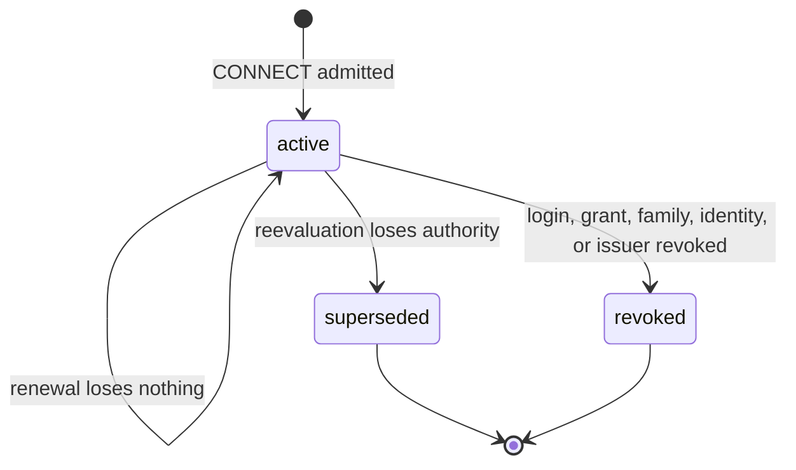
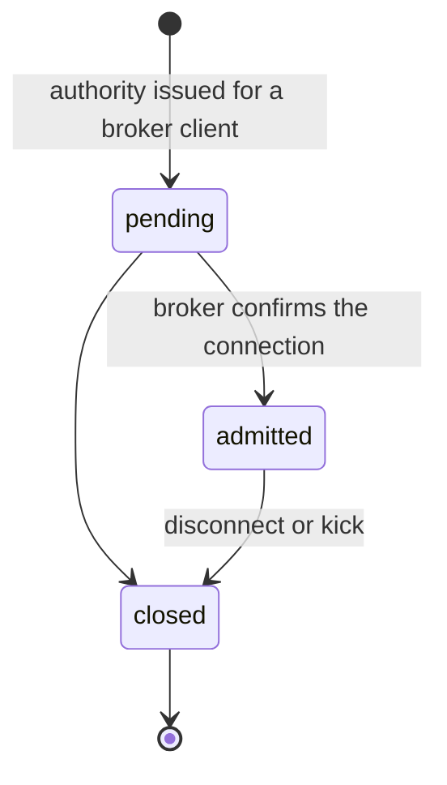
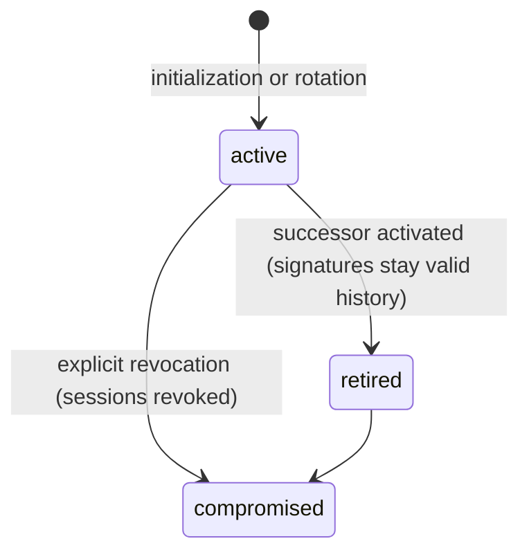

# Design: Trellis Authentication And Authorization

Status: Revision 7, unreleased. A clean break: there is no compatibility path
for GrantBinding, route tokens, or the former browser bind protocol.

This document describes the model: what Auth stores, how each record lives and
ends, how a connection receives authority, and how a policy change takes it
away. The [appendix](#appendix-rules-by-code-path) lists the detailed rules,
grouped by the code that enforces them. Related documents:
[administrative capabilities](./administrative-capabilities.md),
[Auth API](./auth-api.md), [Auth protocol](./auth-protocol.md),
[device activation](./device-activation.md), and
[operations](./auth-operations.md).

## The model

Auth owns every authorization decision in one SQLite database. A connection
never carries policy: it proves who it is, Auth compiles that principal's
current authority, signs it as a short-lived **session authority**, and admits
the connection with a transport policy derived from it. Providers and callers
verify signed authority; they never resolve roles, consent, or grants
themselves. When policy changes, Auth reevaluates the affected sessions and
retires any that lost authority, publishing signed revocations and kicking their
connections. NATS KV only distributes published material; it is never
authoritative.

## Entities

| Entity                         | Table                                                                          | What it is                                                                                                                                                              |
| ------------------------------ | ------------------------------------------------------------------------------ | ----------------------------------------------------------------------------------------------------------------------------------------------------------------------- |
| Principal                      | `auth_principals`                                                              | A user, service, or device identity. `active`, `disabled` (reversible), or `revoked`.                                                                                   |
| Login session                  | `auth_login_sessions`                                                          | One verified sign-in, local or upstream OIDC. OIDC logins carry verified claims with a freshness deadline.                                                              |
| OAuth client                   | `auth_oauth_clients`, `auth_cimd_clients`                                      | A registered public client, or one known only from its client ID metadata document.                                                                                     |
| OAuth grant                    | `auth_oauth_grants`                                                            | One user's approved delegation to one client binding (browser origin or native DPoP key): the selection, the approved capabilities and groups, and their consent basis. |
| Refresh family                 | `auth_oauth_families`                                                          | One chain of rotating refresh tokens under a grant. Revocation is irreversible.                                                                                         |
| Deployment, instance, identity | `auth_deployments`, `auth_instances`, `auth_provisioned_identities`            | An installed service or device participant, its running instances, and their identity keys.                                                                             |
| Capability, group              | `auth_capability_identities`, `auth_capability_group_members`                  | An API's unit of approval (`api.vN:area.action`) or a developer-defined bundle of them (`api.vN:name`), each with an identity generation and consent revision.          |
| Entitlement path               | `auth_direct_capabilities`, `auth_role_assignments`, `auth_oidc_role_mappings` | How a principal holds a capability or group: a direct grant, a role, or an identity-provider claim mapped to roles.                                                     |
| Logical authorization session  | `auth_authorization_sessions`                                                  | One runtime's continuing authority under one credential root. `active`, `superseded` (lost authority), or `revoked` (root gone).                                        |
| Session authority              | `auth_session_authorities`                                                     | An immutable, issuer-signed `trellis.session-authority.v1`, addressed by digest and retained as history.                                                                |
| Attachment                     | `auth_attachments`                                                             | One physical broker connection bound to a session authority and ephemeral NKey: `pending`, `admitted`, or `closed`.                                                     |
| Issuer                         | `auth_authorization_issuers`, `auth_issuer_rotations`                          | Auth's signing key: `active`, `retired`, or `compromised`, linked by signed rotations.                                                                                  |
| Enforcement work, effects      | `auth_enforcement_work`, `auth_post_commit_actions`                            | Durable scoped reevaluation work, and ordered effects (revocations, kicks, publications) committed with the change that caused them.                                    |

## Lifecycles

A logical authorization session keeps one ID across renewals only while nothing
was lost; any reduction retires the ID for good.

A retired session's credential root may still be valid; the runtime then
connects again under a new logical ID with whatever authority remains.

An OAuth grant is created when the user approves, lives until it expires or is
revoked, and owns refresh families. Revoking a family retires every session
whose original family it was; revoking the grant revokes all of them.

## Entitlements

One compiler (`policy::evaluate`) decides authority, reading one SQLite
transaction:

1. **Holdings.** The union of the principal's direct grants, role assignments,
   and, for an OIDC login, roles mapped from that login's fresh verified claims.
   A held group counts as its current members. The initialized administrator
   additionally holds every administrative capability inherently.
2. **Selection.** What the credential asks for: an app's requested
   capabilities and groups, or a deployment's installed participant selection.
3. **Consent.** For an OAuth grant, only what the user approved at the approved
   consent revision. A selected group yields the members of the revision the
   user approved, less any since removed.
4. **Result.** Approved capabilities (holdings ∩ selection ∩ consent), required
   selections that are missing, accepted API generations, provider bindings,
   resource-binding evidence, explanations, and the earliest deadline among the
   credential and each carried right.

Each entitlement path stands alone: losing one path never removes a capability
another path still grants, and freshness expiry removes only the affected OIDC
path.

## Issuance pipeline

1. The broker's Auth Callout receives a CONNECT, checks the server, account,
   expiry, and request key, and verifies the nonce signature with the
   connection's ephemeral NKey (`auth_callout.rs`).
2. The CONNECT token is the credential: a short OAuth admission bound to the
   DPoP key from the token endpoint, or a provisioned identity proof signed by
   the installed identity key (`revocation.rs`, `admit_connection`).
3. In one transaction, Auth checks the credential root: principal active; login,
   grant, and original refresh family live; client active; or deployment and
   instance current (`authorization_sessions.rs`, `credential_snapshot`).
4. The compiler evaluates authority. A missing required selection denies
   admission.
5. On renewal, the logical ID survives only if no still-usable authority issued
   under it carried anything the new result lacks (`loses_authority`).
   Otherwise the session is retired and a new ID begins.
6. Auth signs the session authority (64 KiB budget) with the transaction's
   current issuer, stores it with its comparison projection, records the
   session and a pending attachment with its transport policy, and commits the
   publication effect.
7. The Callout returns an authorized-user JWT carrying that transport policy.
   The SDK verifies its signed authority before any application work.

## Enforcement pipeline

1. Every policy change is an idempotent aggregate mutation. It authorizes the
   actor, applies the change, and commits scoped enforcement work in the same
   transaction.
2. The commit wakes the enforcement and effect workers. Work naming one session,
   grant, login, identity, principal, or deployment runs in a targeted lane
   ahead of broad scans (an API, capability, role, client, provider, issuer, or
   everything), which yield at page boundaries.
3. A worker pages the sessions in scope through indexed lookups, reevaluates
   each with the same compiler, and compares with its live authorities.
4. A session that lost authority is retired; one whose root is gone is revoked.
   Retirement records its cutoff, signed revocation, and exact attachment kicks
   atomically.
5. The effect publisher sends signed revocations before the kicks that depend
   on them, and kicks only the exact broker connection it recorded.
6. SDKs keep a verified mirror of revocations. Authority is usable only while
   that mirror's coverage is current; a lost or unverified mirror fences new
   work rather than permitting it.

## Consent and delegation

Interactive approval is opt-in: only required access and remembered choices
start selected. The server rechecks the submitted selection against current
holdings in the approving transaction, and a changed meaning requires a fresh
presentation. Remembered consent is per user, client binding, capability or
group, identity generation, and consent revision.

A group grants its members. Its holders see membership changes immediately;
growth requires a higher consent revision, so an app keeps the members its user
approved until asked again, while removed members disappear everywhere.

Administrative capabilities, and groups that contain one, carry three
safeguards configured under `[auth.administration]`: a separate confirmation
step, peer approval by another `trellis.auth.v1:platform.manage` holder, and
registered clients only. See [administrative
capabilities](./administrative-capabilities.md).

## Catalog acceptance

One accepted definition exists per API major. Review authenticates the package
evidence, computes compatibility, records action, capability, group, and consent
changes, and binds the policy revisions it affects; acceptance rechecks all of
them in its transaction. Normal acceptance raises the accepted revision, and new
actions and memberships record the revision that introduced them, so an older
signed authority cannot gain them. Force replacement starts a new generation.
Only the APIs Trellis ships may use the `trellis.` namespace.

## Durable state and caches

Session authority rows are permanent history: expiry, disconnect, grant
replacement, login revocation, and issuer rotation never delete them, and
explicit revocation is separate associated state. Effects and typed events are
ordered post-commit actions; delivery preparation is claim-fenced and retries
reuse the exact prepared bytes. KV mirrors, connection inventories, and SDK
caches are rebuildable; there is no durable rollback floor or context cache.

---

## Appendix: Rules by code path

### Listeners and installation identity (`config/`, `listener.rs`, `oauth/http.rs`)

Fresh initialization generates `auth.instance_id` as a canonical ULID. Retain it
with the installation configuration and database across restarts and all key
rotations; startup requires it rather than inventing a new identity.

`auth.oauth` explicitly configures the dedicated listener's `origin`,
`bind_address`, `port`, and `transport`; `[http] transport` configures the
application (Console) listener the same way. Each transport is one of:

- `tls`: HTTPS with `certificate_chain` and `private_key` PEM paths resolved
  relative to the runtime configuration. The origin must be HTTPS. Startup
  refuses an expired certificate or one whose SANs do not name the origin host,
  and the listener reloads replaced files without a restart; a replacement that
  fails to load keeps the previous certificate serving.
- `proxy`: plaintext behind an HTTPS-terminating reverse proxy. The public
  origin must be HTTPS and `trusted_proxies` lists the proxy networks. Peers
  outside those networks receive `403`. The client address used for per-client
  limits is the first untrusted `X-Forwarded-For` entry read right to left, so
  a client cannot spoof it past a trusted proxy. The proxy must preserve `Host`.
- `loopback_development`: explicit plaintext restricted to an HTTP loopback
  origin and a loopback bind address. An omitted application transport selects
  it and binds loopback by default. It is never a TLS fallback.

There is no insecure-origin allow-list: a remote origin is served only over TLS
or behind a trusted HTTPS proxy, because OAuth's `__Host-` `Secure` cookies and
browser credential custody require a secure context. The OAuth origin must
differ from all configured application origins. A shared hostname is allowed but
requires a prominent cookie-scope warning, because cookies are not port-scoped.
Console assets and application routers are never mounted on the OAuth listener.

Request admission budgets each client address, and additionally each browser
`Origin` when the header is present. Requests without `Origin` (native token
clients, navigations, asset loads) share no common budget. Expired budget
windows restart when next used and the table is swept only when full. Forwarding
headers are ignored unless the TCP peer falls inside
`auth.oauth.trusted_proxies`, a list of CIDR ranges (`/32` or `/128` for one
address). For a trusted peer, the client is the right-most `X-Forwarded-For` hop
outside those ranges, and a malformed header is rejected. Use it for a proxy in
front of a TLS listener, such as one that re-encrypts; a `proxy` transport
already admits only its own trusted proxies and presents the forwarded client.
Both use the same walk.

Remote deployments use native TLS NATS and WSS in addition to the dedicated
HTTPS OAuth listener. Native NATS always terminates its own TLS, because its
protocol upgrades to TLS after a plaintext `INFO` and an ordinary TLS proxy
cannot terminate it; only the WebSocket listener may sit behind an
HTTPS-terminating proxy. The runtime can be that proxy: with
`[http] nats_websocket_upstream`, the application listener relays WebSocket
upgrades on `/nats` to the broker's plaintext WebSocket listener and advertises
`wss://<public origin>/nats` instead of configured WebSocket hints, so a browser
trusts one host and certificate. Production deployments with publicly trusted
certificates can still expose the broker's WebSocket listener directly. Runtime startup selects its rustls provider before
opening NATS. `[nats] ca_certificate` names a private CA the runtime trusts for
its own broker connections, built-in providers, and split-role Auth discovery;
publicly trusted brokers omit it.

### Installation TLS (`crates/bootstrap/src/tls.rs`, `tls.rs`)

Initialization generates TLS material unless the operator supplies certificates
or selects loopback development. Generation creates an installation CA whose
name constraints permit only the configured Console, OAuth, NATS, and WebSocket
hosts (plus loopback names for the co-located broker), and issues short-lived
serverAuth leaves for the runtime and broker. Leaves carry their names only in
SANs. The CA private key is written beside the bundle (`<out>-tls-ca/` by
default), never inside it, so no runtime or broker role that mounts the bundle
can mint certificates. `trellis tls renew` reissues leaves with the same names
and fresh keys from that CA; clients that trust the CA need no change. The
runtime reloads its leaf automatically; the broker reloads on its ordinary
reload signal.

`[tls] generated_ca_certificate` marks an installation serving its generated
CA. The runtime then warns operators at startup with the CA's SHA-256
fingerprint, and the bundled Console and the Login Portal show every user a
short banner: this Trellis is using self-generated certificates and may not be
suitable for production. Trellis never installs system trust and never disables
verification.

Clients trust a private installation CA only through explicit configuration:
`RuntimeAuthorizationTrust.root_certificates` in Rust (supplied by provisioning,
`discover_native_oauth`'s roots, or `trellis login`'s `--ca-certificate` or a
CA the user accepted by fingerprint and pinned), and the
Node runtime's `NODE_EXTRA_CA_CERTS` for TypeScript participants. Non-empty Rust
roots are the only trust anchors for that installation's OAuth and broker TLS. A
broker or metadata response can never supply them. Observable configured origin
conflicts fail before binding a listener. Operators must also keep external
reverse-proxy routes and aliases separate: the runtime cannot inspect an
unconfigured proxy's routing table or discover that two public hostnames are
mapped onto one origin.

### OAuth storage key custody (`oauth/storage.rs`)

Fresh initialization provisions `auth/oauth-storage.key`, independently of the
online issuer, as an owner-only `0600` file containing a base64url 32-byte key.
`auth.oauth_storage_key_file` selects it; relative paths resolve against the
runtime configuration file. Retain and back up this key together with Auth's
database. Issuer rotation does not replace it. Bootstrap refuses to overwrite
existing material. The OAuth adapter refuses missing, malformed, symlinked, or
non-private key files and authenticates existing encrypted OAuth material before
accepting new writes. Key files must be owned by the process user, have no other
hard links, and fit the bounded encoded-key format. Opening refuses symlinks
without following them. Production startup uses this custody loader and never
generates a replacement key.

### Authorization HTTP boundary and Portal (`oauth/http.rs`, `oauth/portal.rs`, `portal/`)

The OAuth adapter bounds form bodies and per-peer/origin request admission,
rejects untrusted Host/HTTP2 authority and cross-origin portal mutations. Public
discovery and issuer-chain GETs allow credential-free cross-origin reads,
including first contact from an unregistered application. Token, device, and
revocation endpoint CORS remains limited to validated client callbacks;
cookie-authenticated Portal mutations do not acquire permissive CORS. Forwarding
headers do not select the peer identity. Expiry cleanup removes transient
portal, proof, device, and token state without deleting immutable authority or
audit evidence.

Portal documents use `Referrer-Policy: same-origin`: cross-origin destinations
receive no referrer, while same-origin forms retain the Origin required by the
strict CSRF check. Accepting `Origin: null` is not a fallback. Own-context
introspection binds its reply to the ephemeral key's derived inbox namespace;
the responder checks that routing before publishing either success or errors.

Console and OAuth portal are separate required frontend apps. Their build tools
use Node 24 LTS, npm workspaces, and Vite; embedded builds compile into staging
before replacing only owner-marked output. Production builds require real
embedded assets; placeholder assets and optional Console builds are not
substitutes for the product.

Interactive OAuth approval initially selects only required access and
capabilities the user previously remembered for the client; optional
capabilities and groups start unselected. Select all and Unselect all are
explicit actions over optional access, and Select all never selects
administration; required access stays selected and unavailable access stays
disabled. Administrative choices are never remembered and take a separate
confirmation step. A requested group is shown with the capabilities it
includes. Selection is presentation, not authorization: the user must still
submit approval, and the server rechecks the submitted selection against current
authority.

Registered-client implied capability consent is browser-only and limited to the
configured subset, the requested selection and the user's current entitlement.
It never substitutes for native approval. Device Code consent shows the user
code beside a warning to compare it with the device and to stop if someone else
sent the code or link; it is not a separate required confirmation. Device codes
last 15 minutes, and the issuer returns `verification_uri_complete` so native
clients print and QR-encode a link with the code filled in.

Code and device consent presentations are retained in their encrypted,
expiring authorization artifacts. Approval submits the presentation identity and
explicitly selected optional capabilities. The grant transaction consumes that
exact presentation and rechecks the displayed capability identity generation,
consent revision, API generation, and current availability. Changed capability
meaning, a superseded form, or lost required availability requires a fresh
presentation; unrelated entitlement changes do not invalidate the form.

### OAuth clients (`lifecycle.rs`, `rpc_credentials.rs`, `initialization.rs`)

The bundled Console's OAuth registration is runtime-owned. Initialization
registers it against the configured Console application origin using the
ordinary registered-client store, then exposes its public client ID and validated
callback URI through Console configuration. Operators do not manually register
the bundled Console. Its client ID is neither a deployment ID nor a secret.
Production administrator seeding initializes the administrator and registers
`trellis.console` and `trellis.cli` in one idempotent aggregate transaction. CLI
is an explicitly registered native Device Code/refresh client without a callback
listener or implicit loopback trust. Registration uses the newly created
administrator's `trellis.auth.v1:clients.manage`. Replay returns the saved
result without re-registering or re-enabling a modified client; ordinary startup
does not change client registration. Registration does not itself grant the user
any capability: delegation still requires the user's holdings and explicit
consent.

Administrative client Put derives supported flows on every revision: browser
with callbacks uses Authorization Code and refresh; native without callbacks
uses Device Code and refresh; native with callbacks uses both flows and refresh.
It replaces prior flow metadata while retaining unrelated registration metadata.
Adding/removing native callbacks enables/disables Authorization Code. Kind
remains immutable because it fixes credential binding semantics; switching kind
requires a new client ID. Native HTTP loopback callbacks need no development
flag, while browser plaintext loopback callbacks require it and retain exact
port/origin matching. HTTPS loopback callbacks are authenticated by TLS like any
other host. An administrator-registered development client, including a
localhost Console, is a registered client; neither development mode nor a
localhost redirect establishes anything further.

Provisional CIMD metadata and its encrypted OAuth engine client artifact are
admitted atomically, with a shared limit of 128 unapproved clients and 16 MiB.
Both receive a five-minute lifetime. Expired, unreferenced pairs are evicted
before admission; exhaustion returns `temporarily_unavailable`. A live pending
authorization retains its exact reviewed metadata until that transaction expires
and rejects replacement with a different document during that interval. Approved
grants retain their client protocol identity and redirect information, not the
full fetched metadata, until their remaining lifecycle ends. Cleanup preserves
refresh-reuse evidence for a still-live family and never deletes authority
history or administrative client registration.

### Upstream identity (`oauth/oidc.rs`, `oauth/upstream_http.rs`)

Dex is exclusively a real upstream OIDC test dependency, not a deployment
component. Trellis validates upstream nonce, signature, issuer, and audience
before translating verified claims through its own role mapping and consent.
Fresh claims replace earlier observations only for the selected upstream subject
at that provider. Two linked identities belonging to one user do not supply or
remove each other's mapped roles. Direct grants remain independent of claim
freshness or upstream role removal.

### The capability compiler (`policy.rs`)

Pending backing resources do not remove an ordinary user's capabilities.
Approval never adds an unknown or declined optional capability at renewal.
Compatible API expansion is available to a renewed context only while the
capability remains approved at the same consent revision.

Fresh explicit approval records grant-local consent provenance. Older remembered
declines or expired approvals cannot veto "approve once," and that one-off
choice does not rewrite remembered policy. Reused remembered choices must still
be approved and inherit their optional expiry. Later shared decisions and
explicit withdrawals still constrain existing grants. Approval commits scoped
enforcement work atomically when it changes remembered consent.

Deadline reductions compare each outstanding context with its shared credential
limit and the current limits of only the rights that context carries. Newly
gained capabilities cannot shorten older, narrower authority. Their limits bound
newly issued contexts, not the persistent logical-session root; spent contexts
are excluded after their acceptance deadline.

Trusted native device provisioning commits the device record with its
principal, deployment, instance, identity key, and entitlements before
authority issuance.

### Sessions and issuance (`authorization_sessions.rs`, `auth_callout.rs`)

Canonical signed session authority is limited to 64 KiB by both issuer and
verifier. Raw parsing applies the same allocation bound even when a caller's
local policy allows more. Issuance fails before authority or attachment state is
committed when the shared budget is exceeded.

Provisioned service/device CONNECT proofs identify the installed credential and
bind its identity-key signature to the fresh runtime/session NKey, target
installation/account, and validity window. Clients do not assert deployment,
instance, participant, or implementation authority. Auth resolves those from its
current provisioning records; an ambiguous credential binding is rejected rather
than selected implicitly. Provisioning supplies connection endpoints and pinned
installation/account/issuer trust, not another copy of deployment policy. The
Auth-signed session authority exposes the verified binding to the SDK, which
still checks its generated provider implementation against the accepted
evidence.

Auth checks the current credential/root, runtime identity, and proof key before
issuing `trellis.session-authority.v1`. It signs canonical bytes and commits the
immutable context, logical-session association, and publication work together.
Resolution by digest returns that exact committed object even after restart.

Renewal compares the new evaluation against every still-usable authority issued
under the session, using the comparison projection stored with each: carried
capabilities, API generations, provider bindings, resource-binding evidence, and
deadlines. Identical projections are compared once, at their latest expiry. A
narrower newest context cannot hide an older broader live context.

Reduction irreversibly retires the ID. A surviving root can reconnect with a new
logical ID after reevaluation. Disabled principals, revoked grants/logins or
provisioned identities, and compromised keys cannot use this route to regain
authority. Physical attachments bind the logical ID to an exact server/client
association, an attachment marker, and the same ephemeral NKey as its proof key.
Attachment admission reevaluates inside the transaction; delayed enforcement
cannot admit an already-retired or newly-reduced session.

OAuth CONNECT retains the original verified refresh family on its logical
authorization session: immutable `original_refresh_family_id` and
`refresh_family_lookup_hash`, with the hash/grant pair referencing the actual
OAuth family's record. Authority renewal, OwnContextGet, Admission.Renew, and
CONNECT reread that exact family's revocation state and absolute deadline; a
different live family of the same grant cannot replace it. The family deadline
limits the shared session root, separately from per-capability deadlines.
Refresh-token rotation preserves the original family identity and deadline.

`Admission.Renew` accepts the live session's ordinary verified ephemeral-key
request and a context digest owned by that exact principal/runtime/session/key.
In one transaction it rechecks current policy, validates and retains a bounded
candidate authority, and uses the token endpoint's signing owner to return a
short OAuth admission for the same key, runtime, grant, login, client, and
original family. Its lifetime is at most 300 seconds and cannot outlive the
candidate authority or family. It neither rotates a refresh token nor provides a
durable reconnect credential. Invalid roots retire the session and enqueue the
ordinary cutoff and kicks; renewal never revives its retired logical ID.
Provisioned credentials still require the client's identity-key signature:
`Admission.Renew` returns `provisioned_signature_required` for that
prerequisite, and Auth never signs on the client's behalf.

Already admitted Trellis connections may request their own context for one
exact physical attachment. The signed AdmissionGet requires canonical
`attachmentId` from that socket's broker marker; its signed response registry
must echo that exact ID. Overlapping sockets of the same runtime/key resolve
independently, never by selecting the newest attachment; foreign, disconnected,
and missing attachments deny.

### Entry routing and providers (`transport.rs`, SDKs)

Ordinary RPC requests, Operation starts, and Live openings use generated
canonical API/action subjects. Auth does not persist caller-to-provider
deployment selections or return such selections in bootstrap metadata.
Providers derive the request queue group from the exact subscribed RPC or Live
opening subject in every SDK and transport generation. Normal broker operation
distributes each request to one eligible subscriber; this is not an exactly-once
execution guarantee, and the SDK never automatically retries potentially
executed work.

Provider authorization is independent of caller capabilities. Signed provider
certificates retain principal, deployment, instance, API generation, and
implemented-action identity. Providers subscribe only to certified actions;
clients verify the actual response against the pending request and certified
provider before exposing either success or a declared error.

Once an opening selects a peer, Live and Transfer controls and frames retain
their authenticated session owner and session-specific subjects. Existing
durable Operation controls and observations retain deployment ownership and the
supported durable coordination mechanism. Canonical entry routing neither merges
service-owned storage nor load-balances established-session traffic.

Providers sharing an API route must be suitable alternatives for that logical
API. Matching IDL alone does not make independent databases or different
physical devices interchangeable. Application code selects an API, while the SDK
retains authenticated peer identity for established work.

### Catalog acceptance (`catalog.rs`)

Request verification evaluates caller grants against the exact signed catalog
referenced by the caller's authority. Provider eligibility is checked separately
against its pinned implementation and provider certificate. Compatible callers
and providers need not have equal accepted revisions within one API generation;
neither party's catalog can lend authority to the other.

Force replacement requires `trellis.auth.v1:apis.forceReplace`, reviewed-digest
confirmation, explicit breakage acknowledgment, and declared meaning changes
with increased consent revisions. It creates a new API generation at revision 1
and makes displaced providers ineligible for admission. Technical wire breakage
alone does not imply that every delegated meaning changed. Retained signed
catalogs support verification and audit, not runtime compatibility fallback.

A group's members are recorded for each consent revision. Within one revision
members may only be removed; adding one requires a higher consent revision.

### Enforcement and distribution (`revocation.rs`, `broker.rs`)

Bounded transactional pages resume from committed cursors after restart,
recompute through the same compiler, and preserve sessions when an independent
entitlement path means nothing was lost. A one-second tick only retries
backed-off effects and recovers expired claims. Capability- and API-scoped work
finds sessions through the `auth_session_capabilities` and `auth_session_apis`
indexes, kept in step with sessions and authorities by triggers.

Ordinary reevaluation uses retirement commit time as the effective cutoff, not
the earlier policy edit time. Direct logout/family/session retirement records
the cutoff in that operation's transaction. Work progress retains policy commit
time separately. Every still-live digest under the retired ID is affected.

Hot revocation entries remain through the maximum context acceptance deadline,
including skew. Durable signed cutoffs remain available for historical
verification.

Kicks use the operational system-account client and exact broker inventory. A
reused CID with another attachment marker is never kicked. Unavailable or
malformed inventory is retryable, not proof of absence. `CONNZ`'s filtered
`num_connections`, not its global `total`, establishes CID absence. Effects have
bounded claims, retry backoff, stale-claim recovery, and predecessor ordering.
An effect's identity includes its predecessor, so an identical payload queued
behind another predecessor is a separate action rather than a dropped edge. An
expired or superseded claim cannot acknowledge or reschedule work and is not an
Auth-host failure. The durable intent remains available to its current or next
owner. Claim settlement includes time spent awaiting broker effects rather than
reusing the batch's original timestamp.

### SDK authority coverage (`crates/trellis/src/client`, `ts/packages/trellis`)

A bounded positive-only verified cache retains known cutoffs through missing
mirror entries; forged updates cannot install or erase a cutoff. A cache miss is
not evidence that unknown authority is valid. Owners use one shared
snapshot/update stream. Live authority is unavailable until its initial snapshot
has been verified and applied, and becomes unavailable if coverage is lost.
Replacement streams use an epoch fence: completion of a retired watcher cannot
restore or clear its successor's coverage. Observed revocations remain sticky;
recovery never extends the signed authority's expiry. Verified authority is
keyed by context digest; usability requires continuous revocation coverage, not
continued attachment to the socket that first resolved it.

Optional-action availability is advisory: a missing live authority snapshot is
unknown, not proof that the action is denied. Finite requests wait for verified
authority before signing and publishing, within their original deadline and
cancellation signal. A current snapshot that excludes the action remains denied;
recovery never retransmits a potentially executed request. An authority carries
a group's member capabilities, not the group, so a selected group is available
when its actions are.

An accepted native RPC may finish while the provider's own authority is being
promoted. Reply signing reacquires a coherent current provider snapshot when
asynchronous certificate resolution overlaps that promotion, within one
configured signing deadline. This repeats only local signing preparation, never
the handler or its application request. Current provider eligibility, issuer
trust, expiry and shared revocation coverage remain required.

A healthy transport rollover stages its replacement mirror without stopping the
current one. The replacement becomes the single authoritative mirror only after
its authenticated snapshot and queued updates have been applied, including any
already-received predecessor updates. Failed preparation leaves the predecessor
authoritative; loss of the predecessor still fences application use until a
complete replacement restores coverage. Superseded watcher completion cannot
clear the promoted mirror's coverage.

Rust retains the predecessor's carrier lease during this handover. A failed or
superseded replacement can fall back only to that still-running, connected
predecessor; stopping a predecessor prevents its restoration. Fresh work on the
replacement stays fenced until its snapshot and exact publication are checked.
Losing the actual covering carrier withdraws coverage without erasing cutoffs.

While an already-received revocation update is being verified and applied,
asynchronous reply verification waits for that owner's ordered update queue,
then repeats its live authority checks. It does not discard a received reply
merely because this bounded ingress fence is active, retransmit the request, or
treat lost or superseded mirror coverage as usable. Fresh application
acquisitions fenced during that update are notified when coverage returns, even
without renewal or transport replacement; they recheck current authority within
their original deadline rather than retransmitting work.

One cancellable supervisor retries unexpected stream loss or a temporarily
missing published carrier with bounded backoff and jitter. Private maintenance
can acquire an admitted carrier while application use remains fenced; only a
complete authenticated snapshot on the current generation restores usability. A
retired session remains denied, but fresh ordinary admission may replace it
under a still-valid credential. Explicit close or terminal credential failure
stops recovery. Explicit native authority refresh and scheduled renewal share
one custody worker and await authenticated publication and mirror coverage. If
the own signed authority expires during mirror loss, restoring the snapshot
alone does not restore application usability. The retained runtime key proves a
fresh admission exchange on the surviving attachment; its verified authority is
promoted before normal renewal resumes. Expired authority never authorizes work.

Own refresh carries the original verified preparation, exact attempt identity,
clock, and CONNECT companions through retention and promotion; digest equality
alone cannot substitute another preparation. Candidate coverage stays separate
from installed own state until the guarded synchronous promotion. Failure,
supersession, or cancellation releases only that attempt's resources, preserving
healthy installed authority and independently borrowed entries. Equal-policy
renewal needs no new socket; safe growth automatically adopts a ready successor.
Accepted work keeps its receiving generation, safe predecessors drain after
lease zero, and unsafe, revoked, or hard-expired generations are forcibly
retired.

Refresh-successor checkpoints apply only to an actual in-progress refresh, never
to a separate Device Code authorization. Rejected cross-principal
reauthorization preserves the previous credential. Browser refresh reloads
durable cross-tab trust under the custody lock and discovers the current signer
before spending its token, even when the OAuth client object remains open.
Node-native replacement attachments reuse admission only while the shared
verifier accepts its lifetime, scope, session key, and current pinned issuer.
Transport loss alone does not spend OAuth refresh custody. Renewal authenticates
the selected HTTP origin before spending the one-use token; unavailable
discovery leaves it unspent, while an ambiguous token POST retains the spent
marker and requires explicit recovery. Failed transport preparation uses bounded
recovery without retransmitting application requests or clearing known
revocations. Native renewal leases the current maintenance attachment rather
than retaining the initial socket; that finite lease carries signer resolution
through the existing private preparation and checked authority-promotion
boundary. Verified issuer-chain changes wake renewal immediately. Private
admission reads use their bound runtime-key proof and retained transport policy
even when application authority needs a new signer; fresh application work
remains fenced until the replacement authority is verified and promoted. When no
safe admitted carrier survives, an expired retained maintenance snapshot does
not require fresh admission to reuse its retired logical session. The same
provisioned credential may receive independently verified replacement authority
with reduced permissions. Installation, pinned issuer trust, runtime proof key,
credential association and signed transport policy remain checked; known cutoffs
are preserved and revoked roots or terminal shutdown cannot recover.

Accepted finite RPC results retain their authenticated opening rather than
requiring that opening's context to remain live at delivery. Ordinary renewal
and opening-context expiry do not reject a signed success or declared error
received within the original request deadline. Current provider trust and
authority, the exact request/response transcript, caller revocation coverage,
known revocation, cancellation and logical shutdown remain enforced. This
evidence cannot authorize a new request.

Provider ingress preparation retains the verified private candidate authority,
not the suspended predecessor. This applies to Live and Operation observation
providers alike. Retention still verifies provider actions against the accepted
catalog and current revocation coverage; the candidate cannot authorize frames
until checked transport publication commits it. Failed preparation retires the
candidate and releases its verifier only after retained installation leases
drain.

### Native client credential custody (`crates/trellis/src/auth`, `ts/packages/trellis/native`)

Provisioned services authenticate with their installed identity seed. They do
not need a local user credential store. Native OAuth custody belongs to
applications acting as a logged-in user, not to ordinary service bootstrap or
discovery.

The Node SDK keeps credentials in process-local memory by default. Closing that
client releases its lease; a fresh default client requires a new authorization.
Applications can retain an explicit `MemoryNativeOAuthCustody` object to resume
the same family across connections within their process. It keeps the DPoP key,
authenticated issuer floor, principal binding, and spent-token state together.
Only one client can acquire that object at a time. No SDK-owned SQLite database,
filesystem credential directory, or implicit remembered login is required.

Remembered login across process restarts is an explicit application-owned
`NativeOAuthCustody` implementation. Its acquired lease must retain exclusive
family ownership across read, exchange, and commit; durably commit the spent
marker before returning a token for submission; atomically retain a received
unsubmitted successor and verified identity; and persist authenticated issuer
trust before spending credentials. The SDK awaits these operations and never
retries an ambiguous token exchange. Failed acquisition does not release another
owner's lease. Credential scope and account binding cannot change on reuse.

The SDK ships no persistent Node backend. Existing Node SQLite credential files
are not migrated, opened, or deleted; those applications must explicitly choose
their credential provider or authorize a new process-local session. The Rust CLI
retains its existing owner-only file custody and operating-system family lock.
Browser IndexedDB and cross-tab Web Lock custody are unchanged.

Browser app sign-out revokes the latest refresh family under the cross-tab
custody lock and clears both its refresh token and principal/grant binding. The
independent Portal login survives until explicitly logged out. A later
authorization may bind the cleared app handle to another account; an uncleared
handle still rejects a different principal, and stale tabs cannot restore it.

`Delegations.Revoke` atomically retires the selected grant and its refresh
families, clears remembered approval for its app binding, and queues
enforcement. It preserves sibling grants and the Portal login. Repeating its
idempotency key returns the original mutation result rather than a revision
conflict.

### Issuers and verification metadata (`authorization_sessions.rs`, `own_context.rs`)

Cold OAuth resume reads the bounded public issuer chain from
`GET /.well-known/trellis/issuer-chain?pinnedKeyId=...&targetKeyId=...` on the
selected OAuth origin. Discovery identifies a target but never replaces a
persisted pin: SDKs authenticate each signed successor's sequence, scope and key
continuity using the existing rotation verifier, then persist successor trust
before consuming a refresh token. Missing, compromised or invalid chains leave
the existing credential unspent. If an issuer changes during refresh, custody
retains the known newly returned, unsubmitted token without promoting unverified
admission authority; later recovery spends that successor, not the already
spent predecessor. Ambiguous responses retain the spent marker.

Cold successor pins resolve older immutable verification material through the
existing issuer-signed metadata exchange's `issuerKey` selector. Only an active
issuer authenticated from the pin and forward rotations may sign this reply; its
requested key, canonical bytes, installation/account, nonce, destinations, and
freshness are verified before caching. Returned keys are historical-only: retired
keys can authenticate unchanged catalogs and historical publications, while
compromised keys remain unusable. The read cannot install an active key, advance
the rotation sequence, or replace credential trust. Learned compromise is sticky.
Current session and provider-certificate checks remain independent of immutable
catalog-signature authenticity.

Issuer rotation installs a signed, preceding-key-bound, monotonic chain record
and retains retired public keys and immutable signed contexts. Issuer
rotation/revocation requires `trellis.auth.v1:platform.manage`; other hard-root
revocation requires `trellis.auth.v1:users.manage`. `Issuers.Rotate` requires
the expected current issuer key and an idempotency key. Auth generates successor
signing custody locally; private keys never enter the RPC. Before committing a
rotation, Auth creates a private `0700` directory beside its effective
persistent SQLite database, replacing the database extension with
`.issuer-keys` (`platform.issuer-keys/` by default). The initial provisioned
seed may remain on a read-only configuration mount. Auth writes a new
content-addressed `<keyId>.key` file with `0600` permissions, and durably flushes
the file and directory. Existing files are never overwritten and unsafe existing
directories are rejected rather than chmodded. The old issuer signs the
successor link. Retirement, successor activation, the signed chain link, its
publication intent, and the idempotent result commit in one SQLite transaction.
Every signer is selected from that transaction's current issuer, so concurrent
issuance cannot mix issuer state and signing custody. Replays return the same
transition without generating another key; stale expected keys conflict. A
precommit failure leaves the old issuer active, with at most an unused key file.
After commit, startup selects the database-current key and fails closed if its
custody is missing or invalid; it never falls back to the bootstrap key or
creates replacement custody. Backups must include the database, configured
bootstrap seed, successor-key directory, and the independent OAuth storage key.
Rotation does not change that OAuth encryption key, revoke existing logical
sessions, or invalidate historical evidence signed by a merely retired issuer.
Explicit key compromise revokes affected sessions and makes that key unusable;
restart must not reinstall it as an active signer.

Already admitted Trellis connections may publish bounded public verification
lookups to `trellis.auth.metadata.get`, regardless of administrative capability.
This dedicated read-only bootstrap uses the IssuerMetadataRequest and
SignedIssuerMetadata protocol for IssuerKey, AuthorityResolve, AuthorityStatus,
and IssuerChain. It is the only NATS path for this material; there are no typed
Auth RPCs for it. Its answers are protocol types (`AuthorityMaterial`,
`AuthorizationSessionStatus`, `IssuerChain`) carrying the exact signed JSON of
each artifact, and verification decodes them for the query that asked. The HTTP
issuer chain serves the same `IssuerChain` for clients that have no NATS
connection yet. The responder shares OwnContext's lifecycle and bounded
concurrency; the ordinary Callout ACL grants only the exact metadata subject.
There is no anonymous listener or account admission. Replies are bounded and
restricted to ordinary `_INBOX.*` destinations, with exact
instance/account/query/nonce/subject/reply binding and a 30-second signed
admission window. SDKs authenticate existing pinned-key rotation proofs before
trusting a new reply signer; broker delivery alone supplies no trust. Missing or
Unavailable never clears known revocation or establishes authority. Lookups
return only the selected immutable verification material, logical status/cutoff,
or pinned-to-target signed issuer chain, never credentials or policy
enumeration.

Cold provider-certificate material reads authenticate the immutable signature,
installation/account binding, identity, and validity bounds without applying
today's clock. Live use still requires a current issuer and unexpired authority
and certificate. Retained events require both signed event time and genuine
original JetStream publication time within those validity windows and before any
signed revocation cutoff; ordinary certificate expiry and issuer retirement do
not invalidate that historical evidence. Compromised issuers remain unusable.

### Accounts and the initial administrator (`initialization.rs`, `lifecycle.rs`, `oauth/account.rs`)

The initial administrator is created through the local production bootstrap
boundary and cannot be disabled; it holds every administrative capability
inherently. Fresh initialization accepts any missing Trellis-owned built-in APIs
from the production Platform, Health, Jobs, and Events participant descriptors
and grants the administrator each currently accepted active capability of those
APIs (Auth, Core, State, Health, Jobs, and Events). These are explicit
whole-capability policy grants committed atomically with Console/CLI
registration, not wildcard authority. Initialization replay neither grants
capabilities added later nor overwrites registered clients. Domain APIs are
excluded. Application connections still require their actual selected and
approved capabilities. Passwords use Argon2; password change/reset retires the
affected login families in the same transaction. Authentication failures do not
identify which credential check failed.

Account reset and identity linking use five-minute, one-use account actions in
the existing isolated OAuth portal. Action creation replay preserves the
original response under OAuth sealing custody, never a renewed deadline. Reset
completion checks the originating logical session, current
`trellis.auth.v1:users.manage`, credential CAS, and protected-administrator
status before atomically changing the password and revoking login/grant
families. Bootstrap-administrator reset remains on the existing local recovery
path. Until the protected administrator sets a password, each startup issues and
prints a fresh setup link before provider admission, superseding prior pending
links. A setup link stays valid until it is used once; recovery and
administrative reset links expire after five minutes. Once a password exists, startup never issues a link without explicit
local recovery. Linking requires the exact initiating portal user and a fresh
nonce/PKCE-verified upstream exchange; provider disablement or a revision change
invalidates the action, and another user's identity cannot be reassigned. Native
forms enforce Origin and CSRF without accepting actor IDs from the browser.

Identity-link approval never redirects its form POST to an external provider. It
rotates the existing action token into a 60-second, one-use, exact-session
handoff and returns a no-store continuation page with an ordinary navigation
link. The same-origin GET authenticates the reviewed handoff before redirecting
to the verified provider. The continuation and redirect suppress referrers;
`form-action 'self'` remains enforced. Wrong-session, cross-user, expired,
replayed or unreviewed handoffs cannot begin upstream linking.

### Profiles, images, and the directory (`profiles.rs`, `avatars.rs`, `rpc_users.rs`)

Profiles are local presentation data, never account-linking or authorization
evidence. `Users.Profile.Update`, selected through `account.edit`, changes only
the verified caller's profile using `expectedRevision` and `idempotencyKey`. Use
the self account's `profileRevision`, not its principal-policy revision. Omitted
fields are unchanged; set-and-clear contradictions fail atomically. Manual emails
are unverified. Clearing email/picture overrides restores eligible
linked-provider fallbacks; `gravatarEnabled` is a private account preference.

Manual names and email take precedence over standard OIDC profile claims. Each
linked identity retains only its bounded presentation snapshot. Missing claims
preserve earlier values; unlinking or disabling a provider recomputes nonmanual
fields without erasing manual choices. ID-token signature, audience, nonce,
expiry and access-token-hash checks are unchanged. Optional UserInfo has a
three-second/32-KiB/no-redirect budget and must match the authenticated `sub`;
it fills missing profile fields only, never policy claims. An operator-selected
issuer retains its configured TLS boundary; other discovered destinations must
pass the same public-only HTTPS/DNS policy as CIMD. Enrichment failure does not
fail otherwise valid authentication. Email equality never selects a principal.

Authorized directory/self reads mint an image-only bearer at the dedicated OAuth
origin's `/profile/avatars/{token}`. It contains only a version, principal ID,
profile revision, expiry and MAC. A domain-separated key derived from retained
OAuth storage custody binds it to the installation; its maximum lifetime is ten
minutes. Issuer rotation does not change that key. Profile changes invalidate
old URLs. Revoking directory access prevents new URLs, not the remaining lifetime
of an already issued image bearer. URLs must not be logged or used as authority.

Directory reads perform no outbound image work. Image GET tries owner override,
linked OIDC picture, then opted-in verified-email Gravatar (trim/lowercase
UTF-8, SHA-256, `s=128&d=404`). Manual/unverified email never supplies Gravatar.
The provider receives an email-derived hash, not the raw email, but the hash
remains personal information. `auth.avatar.external_fetch_enabled=false`
disables all remote-derived delivery, including cached images; initials remain
local.

Fetching reuses CIMD's public-only pinned DNS resolver, rejects private/reserved
addresses, non-HTTPS, credentials, fragments, non-default ports and redirects,
and carries no OAuth cookies or tokens. Eight bounded fetch/decode slots and a
three-second total budget protect the listener; image requests have a separate
rate budget from login and token requests. At most 256 KiB of PNG/JPEG/WebP is
decoded within 2048-pixel/32-MiB limits, oriented and re-encoded as a static
128-pixel PNG without metadata, capped at 128 KiB. SQLite caches success for
seven days, absence for one day and transient failure for fifteen minutes.
Source/profile changes discard earlier cache entries. Failures return no image,
never a directory/login failure or a redirect to an upstream image host.

Image responses use private caching bounded by bearer expiry, `nosniff` and
cross-origin image embedding without credentialed CORS. Consumers use
`referrerpolicy="no-referrer"`, local initials on image error and a new
authorized directory read to renew an expired URL.

`trellis.auth.v1:users.read` authorizes `Users.List` and `Users.Get`. Its
consent explicitly covers names, email and photos. Ordinary callers see active
user profiles only: `principalId`, `displayName`, optional given/family names and
email, `emailVerified`, and an optional Trellis-owned avatar URL. The immutable
principal ID is the identity key; names and email are neither unique nor
authorization. Unknown and inactive users have the same `not_found` result for
ordinary reads.

`account` contains the principal lifecycle/revision, username and local-password
status. List/Get include it only when `trellis.auth.v1:users.manage` was
delegated to the verified session and is still held at the read transaction.
Holding it without delegating it never expands a client's delegation.
`Users.Resolve` requires `trellis.auth.v1:account.read`, is self-only, and
includes the caller's own account. Directory capability does not authorize
account mutations.

List pagination is principal-ID ordered, defaults to 50 and is bounded to 200.
Ordinary substring search covers available profile fields, not login usernames;
qualified administrators can also search usernames and inspect inactive users.
Profile provenance, richer name ingestion and avatar delivery are separate from
the directory authorization boundary; unavailable optional fields are omitted.

### Deployments, resources, and split roles (`deployments.rs`, `resources.rs`, `rpc_resource_bindings.rs`)

Both local/container and native fresh-bootstrap generators provision the four
built-in provider identity files under the existing `live-providers/` custody
paths. They create private files without replacing existing material. Normal
startup only reads those seeds and fails on missing, unsafe, or corrupt custody;
it does not generate replacement identities or persist private seeds in Auth
SQL.

The Auth-owning host provisions its selected generated built-in provider
descriptors through ordinary API acceptance and deployment approval, using
independently keyed initialization mutations per installation and participant.
Replay retains the actual ULID deployment and instance; disabled, expired,
retired, or mismatched identities are rejected rather than re-enabled.
Declaration-derived resources are materialized before native admission; an
empty projection is valid only for an installed participant with no
declarations. Deploying a participant that selects administration requires
`trellis.auth.v1:platform.manage`.

Disabling a deployment retires its sessions and denies new admission without
detaching allocations or clearing resource commitments. Enabling it reuses those
retained bindings; it does not require contract reapplication or recreate
storage. Deployment removal and declaration omission still detach allocations
while preserving physical data for explicit administrator decisions.

Split roles are independently deployable hosts. Each uses its own provisioned
identity seed, configured NATS endpoints, and trust established from
provisioning or the explicitly selected Auth HTTPS origin (loopback HTTP in
development). Admission uses ordinary Callout and signed own-context; it does
not initialize an unknown identity or read another role's database, issuer
signing seed, or OAuth custody key. Auth alone owns provisioning and
authorization records. Jobs history, resource resolution, and Events ownership
checks must obtain authoritative resource evidence through an authenticated
contract-owned Auth service boundary, not a shared filesystem. An Auth-owning
process can check admission against its own provisioning result without making
that database a dependency of split roles.

`Auth.ResourceBindings.Query` is the native-IDL, paginated read boundary for
runtime Job and Event consumer evidence. `trellis.auth.v1:bindings.readJobs` and
`trellis.auth.v1:bindings.readEvents` authorize only their respective resource
kinds even though they share the route. Jobs and Events declare their own
required read capability; neither receives administrative mutation authority.
Responses carry typed physical bindings and ownership, installed revision,
retained evidence state, and the current resource-bindings digest only when the
deployment and allocation are still current and ready. History and
consumer-owned actions match that digest against verified caller authority
before accessing retained data. Unavailable Auth evidence fails the operation;
roles do not keep a local catalog replica or fall back to another host's
database. Events telemetry uses the same authenticated read boundary within its
existing poll deadline. Applying identical participant declarations carries
forward only ready allocation evidence verified at the immediately preceding
binding revision. Changed or unmaterialized declarations, detached allocations,
and already-stale evidence remain unavailable until ordinary resource
reconciliation succeeds.

First-time resource provisioning may finish an interrupted allocation using the
same incarnation and retained infrastructure. Once materialization has
committed, missing durable consumers, KV buckets, object stores, or Operation
storage are storage loss, not an invitation to create empty replacements.
Materialization fails closed and retains the prior durable evidence even after a
failed retry. The same rule applies to previously committed shared Job
keyed-coordination storage: losing it must not reset active ownership fences or
cleanup obligations. Existing resources must still pass ownership and
data-retention validation.

The runtime wiring loads the fresh store, accepts built-ins and provisions
Runtime resources/identity, issues Runtime authority through the compiler, opens
TLS-protected operational NATS clients, starts Callout, verification
distribution and enforcement, then exposes normal admission/OAuth. There is no
anonymous application-account bootstrap or permanent browser admin token.

The platform bootstrap helper uses ordinary catalog acceptance and deployment
approval under the initialized administrator's administrative capabilities; it
never re-enables or reassigns a disabled provisioned identity. Startup KV
materialization reads the installed native declaration set, performs JetStream
allocation outside the SQLite lock, then commits catalog resource/history,
binding evidence, and the actual `ServiceResourceBindings` projection through
the existing idempotent aggregate mutation. Resource identity includes the
deployment, participant, kind, and local name. Existing allocations must prove
that ownership and retain compatible history/TTL; startup does not adopt,
destroy, or recreate foreign or incompatible storage. Desired capacities are not
converted into hard broker limits. The helper connects only after committing
actual bindings, using configured native endpoints, the store's issuer pin, and
the provisioned identity seed through ordinary Callout and signed own-context.
The host must start Callout, ContextGet, and registry publication before
invoking that helper, and own its returned service runtime. Operation
repositories and staging stores participate in deployment resource
materialization and are committed before provider admission.

### Events consumers (`crates/runtime/src/events`)

Event Consumer exhaustion, including replay exhaustion, is broker-owned: SDKs
leave the final failed delivery unacknowledged and Events journals the captured
MAX_DELIVERIES advisory. Consumer services receive the implicit
`trellis.events.v1:replays.process` capability only for retained inspection and
terminal replay reporting. Both require an exact current owned Consumer binding;
ownership does not authorize Replay/Dismiss. Successful or permanently rejected
replay is durably reported before ACK/TERM. A JetStream acknowledgement address
correlates delivery only: a successful progress response is neither an
authorization credential nor evidence that the delivery remains pending. The
journal distinguishes permanent replay rejection from broker exhaustion; both
return the entry to `dead`, retaining the failure reason for management.
Applying a new Consumer declaration does not upgrade running instances: old
instances become stale, and provisioning a current-revision instance
materializes the new binding and selects its scoped authority. Omitting the
declaration denies the previously authorized binding.

Generated Rust ephemeral and explicit-acknowledgement Event subscriptions verify
the actual subject, original bytes and proof before exposing decoded data.
Ephemeral delivery requires live publisher authority; invalid publications are
dropped without ending a healthy stream. Current subscriber authority remains
independent of publisher authenticity, including for retained delivery. Durable
consumers verify at the broker's original publication time. The existing
dead-letter journal retains that time with the original stream, sequence, bytes,
and proof headers even after source retention removes the event. Targeted replay
resolves those bytes and `originalPublishedAt` through authenticated,
resource-scoped Events inspection; neither replay-envelope content nor publisher
headers supply trusted chronology, and the replay stream's newer timestamp is
never substituted. The Events journal stores only context-digest references and
useful projections, resolving immutable context history from Auth when
validating old events.

### Source boundaries

Core implementation: `crates/runtime/src/platform/auth/`. Pure signed-authority
and verification-material cryptography: `crates/protocol/src/authorization.rs`
and `crates/protocol/src/catalog.rs`. Native Auth contract authoring:
`crates/builtin-contracts/src/builtin_source/auth.trellis`. Generated clients and
current source define exact APIs.
